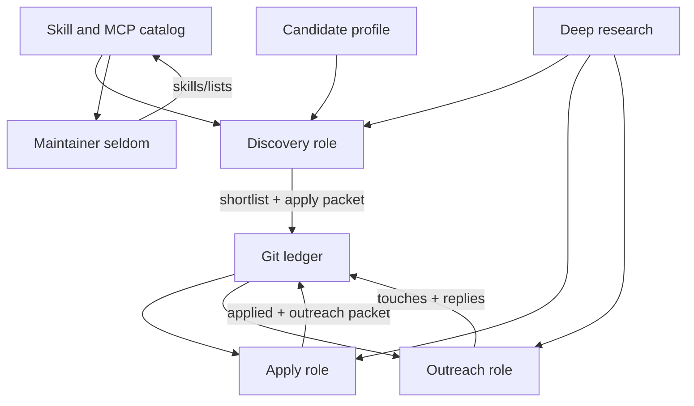

# Job Apply OS

A template for a **distributed job search**, not a single auto-apply bot.

One repo. Three exclusive job-search roles, plus a seldom-used maintainer. One shared ledger. Bots can be airgapped.

```
Discovery finds and shortlists.
Apply submits with writing worth reading.
Outreach follows up by email and LinkedIn only.
Maintainer (seldom) updates skills and MCP lists.
Nobody jumps the queue.
```

This is the agent-facing operating system: how to pick a role, which skills and MCPs to attach, how to share work without hosting a server, and how to hand off a job so another bot can finish it.

## Start here

1. Copy [`profiles/candidate.example.yaml`](profiles/candidate.example.yaml) to `profiles/candidate.yaml` and tell the truth.
2. Put resume PDFs in [`assets/resume/`](assets/resume/) (gitignored).
3. Read [`docs/process.md`](docs/process.md) once. That is the contract.
4. Pick a role in [`AGENTS.md`](AGENTS.md). One bot may hold every role. Several bots may split a role by portal or channel.
5. Discovery owner runs [`skills/skill-and-mcp-catalog`](skills/skill-and-mcp-catalog/SKILL.md) first, then [`skills/deep-research`](skills/deep-research/SKILL.md), then [`skills/job-discovery`](skills/job-discovery/SKILL.md).
6. When the work is the **skill tree** (find MCPs, prune, write lists), claim **maintainer** and run [`skills/skill-maintainer`](skills/skill-maintainer/SKILL.md). That is not a discovery cycle.
7. Everyone writes to [`ledger/`](ledger/README.md). Git is the live list. No deploy required.

## Why this is split

Combined “search and Easy Apply” agents optimize for volume. This template optimizes for **reproducible shortlists**, **attractive applications**, and **human follow-up**.

| Role | Allowed | Forbidden |
| --- | --- | --- |
| Discovery | Find, enrich, score, shortlist, write an apply packet | Easy Apply, form submit, outreach |
| Apply | Submit using the packet, write the message, log proof | Inventing jobs, cold outreach, skipping the packet |
| Outreach | Email + LinkedIn DM after apply (or when there is no portal) | SMS, WhatsApp, spam, applying |
| Maintainer (seldom) | Search registries, vet, write `skills/lists/`, patch example MCP config | Discovering jobs, applying, sending mail |

Roles can be subdivided:

- Discovery by portal (Indeed vs YC vs Amazon careers)
- Apply by ATS (Greenhouse vs Workday vs LinkedIn)
- Outreach by channel (email vs LinkedIn DM)
- Maintainer is not subdivided; it is rare and repo-wide

The ledger stays the same. That is the point.

## Architecture in one picture



Full writeup: [`docs/architecture.md`](docs/architecture.md).

## Shared list without hosting

Bots may have no shared network except git.

| Layer | What it is | When to use |
| --- | --- | --- |
| Canonical | One YAML file per job under `ledger/jobs/` | Always |
| Human view | [`ledger/INDEX.md`](ledger/INDEX.md) | Always |
| Audit | Append-only `ledger/events.jsonl` | Always |
| Optional overlay | Google Drive / Sheet owned by discovery | Only if someone is online and wants a spreadsheet |

Discovery owners the ledger “portal”: they resolve conflicts, rebuild the index, and keep schema honest. Others append and update their own records. Details: [`docs/sharing.md`](docs/sharing.md).

## Skills in this repo

| Skill | Owner | Job |
| --- | --- | --- |
| [`skill-and-mcp-catalog`](skills/skill-and-mcp-catalog/SKILL.md) | Discovery first, maintainer as subroutine | Discover, vet, and add skills/MCPs from any registry |
| [`skill-maintainer`](skills/skill-maintainer/SKILL.md) | Maintainer (seldom) | Search registries, write `skills/lists/`, prune dead tools |
| [`deep-research`](skills/deep-research/SKILL.md) | Shared | Company, people, role, and portal research |
| [`job-discovery`](skills/job-discovery/SKILL.md) | Discovery | Portals, career sites, dorks, shortlist, apply packets |
| [`job-apply`](skills/job-apply/SKILL.md) | Apply | High-quality submit + proof |
| [`job-outreach`](skills/job-outreach/SKILL.md) | Outreach | Email with PDF, LinkedIn DMs, ask for a chat |

Registries are not locked to one marketplace. Use skills.sh, Skills Hub, ClawHub, GitHub, mcp.so, Smithery — whatever you can search, vet, and install. See [`docs/catalogs/skills-and-mcps.md`](docs/catalogs/skills-and-mcps.md).

## Default tool stack

Attach what you have. Degrade if you do not.

| Need | Preferred | Fallback |
| --- | --- | --- |
| Deep research | Exa MCP (`deep_researcher_*`, `agent_run`, company + people search) | Local [dzhng/deep-research](https://github.com/dzhng/deep-research) (`scripts/run_deep_research.py`), Firecrawl, Tavily, Parallel Search MCP (`https://search.parallel.ai/mcp`), built-in web search |
| Job search API | Official Indeed MCP (OAuth) | Public pages + Google dorks |
| YC startups | `uvx workatastartup-mcp==0.1.2` (`bash scripts/mcp/workatastartup.sh`) | workatastartup.com in a browser |
| Remote feed | `https://remoteok.com/api` | RemoteOK site |
| Email + PDF | Gmail MCP draft with `attachments[].content` as base64 | Manual send from the draft |
| Verified contact email | Hunter MCP (`https://mcp.hunter.io/mcp`) | LinkedIn DM only if unverified |
| LinkedIn DM | Logged-in browser / official LinkedIn tools you already have | Copy the DM into the ledger for a human to send |
| Browser apply | Playwright MCP (`@playwright/mcp`) on the apply bot only | Human completes the last submit |
| Public ATS boards | `uvx ats-jobs-mcp==1.0.0` (`bash scripts/mcp/ats-jobs.sh`) | Google dorks + employer careers page |
| Hiring Cafe | `python3 scripts/fetch_hiringcafe.py` | Public hiring.cafe `/jobs/{slug}` page |

Do not scrape behind logins you do not own. Do not build exploit PoCs. Prefer official APIs, public feeds, and career pages.

## Portals this template already names

Job boards and feeds: LinkedIn Jobs, Indeed, Wellfound, Work at a Startup, Google Jobs / dorks, RemoteOK, Hiring Cafe, Weekday, Roro Remote.

Talent networks with little or no public board: Flexiple, Turing, BairesDev, Toptal, Lemon.io. Those are usually **outreach or network-apply**, not Easy Apply.

Big-company career sites: Amazon, Microsoft, Google, Uber, and the rest of the catalog in [`docs/catalogs/big-tech-careers.md`](docs/catalogs/big-tech-careers.md).

Full map: [`docs/catalogs/platforms.md`](docs/catalogs/platforms.md).

## Status contract

```
discovered → enriching → shortlisted → apply_ready → applying → applied
                                                      ↘ apply_blocked
applied → outreach_ready → outreaching → waiting → chatting → interview → offer
         ↘ skipped / closed_rejected / closed_withdrawn / closed_expired
```

Discovery may set `skipped`. Apply may set `apply_blocked` with a reason and a packet update. Outreach never silently rewrites a job’s title, company, or apply URL.

## What “good” looks like

- Discovery output is a **packet** another bot can apply from tomorrow with no chat history.
- Apply output is a message a hiring manager might actually finish reading, plus proof of submit.
- Outreach output is a short email with the PDF attached, a LinkedIn DM asking for a chat, and a logged touch.
- The ledger is the only memory that matters.

## Repo layout

```
AGENTS.md                 How a bot picks a role and behaves
docs/process.md           The full contract
docs/architecture.md      Components and data flow
docs/roles.md             Split / combine / subdivide roles
docs/sharing.md           Airgapped ledger protocol
docs/catalogs/            Platforms, MCPs, career sites, research
docs/research/            Build plans (MCP coverage, deep-research wrap)
skills/                   Agent Skills (SKILL.md) — canonical OS skills
.agents/skills/           Downloaded third-party Agent Skills (npx skills add)
.claude/skills/<name>     Per-skill symlink for Claude Code
.cursor/skills/<name>     Per-skill symlink for Cursor
skills/lists/             Maintainer board: adopted / wanted / rejected YAML
vendor/mcp/PINNED.txt     uvx / git SHA pins for local MCPs (no source trees)
mcp/hosted/               Copy-paste hosted MCP snippets
mcp/SETUP.md              How to attach local vs hosted MCPs
.cursor/environment.json  Cloud-agent install (clones open-deep-research)
ledger/                   Shared live list
profiles/                 Candidate profile (example committed)
mcp/                      Example MCP config
handoffs/                 Packet templates
assets/                   Resumes (local) + writing templates
scripts/rebuild_index.py  Optional INDEX.md generator
scripts/rebuild_skill_index.py  skills/lists/INDEX.md from YAML
scripts/setup_deep_research.sh  Clone dzhng/open-deep-research
scripts/run_deep_research.py    Non-interactive research API wrapper
```

## Run a cycle

```bash
# optional, if uv is available
uv run scripts/rebuild_index.py
uv run scripts/rebuild_skill_index.py
```

Then, in the agent:

- Discovery: “Run the discovery skill for this candidate. Do not apply.”
- Apply: “Apply only to jobs in apply_ready. Write like a human worth reading.”
- Outreach: “Work outreach_ready. Email + LinkedIn only. Attach the PDF on email.”
- Maintainer (seldom): “Refresh skills/lists. Find MCPs. Do not discover jobs.”

## Public template

This repo is meant to be copied, then maintained. Keep process changes in `docs/`, keep skill instructions executable, keep live candidate data out of git.

License: [MIT](LICENSE).
