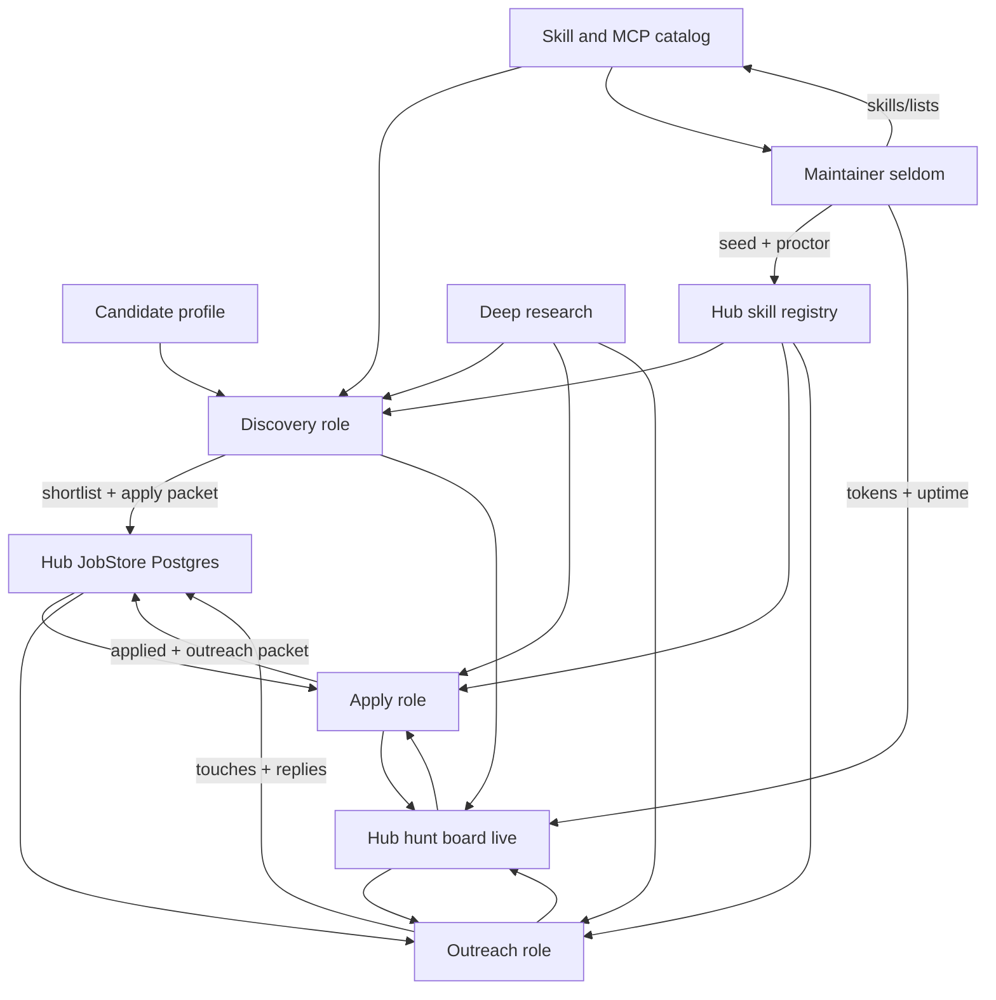

# jobOS

[](https://github.com/unownone/jobos/actions/workflows/ci.yml)
[](https://github.com/unownone/jobos/actions/workflows/deploy-check.yml)
[](https://github.com/unownone/jobos/actions/workflows/deploy.yml)
[](LICENSE)

[](https://cursor.com/en/download)
[](https://github.com/unownone/jobos)
[](docs/install.md)
[](docs/demo/README.md)
[](https://railway.com/new/template?template=https://github.com/unownone/jobos)
[](docs/coolify.md)

**jobOS** is a **job harness** — the only harness you need to find a job. It can be distributed among multiple agents for an efficient loop and better recon.

One-click / easy deploy uses this repo’s Hub image (`Dockerfile`) and Compose (`docker-compose.yml`, Hub on **8787**). **Railway:** button above → `railway.json` + root `Dockerfile` (maps PaaS `PORT` to Hub). **Coolify:** new Docker Compose resource → GitHub `unownone/jobos` → compose file `docker-compose.yml` → keep named volumes `pgdata`, `blobs`, and `rabbitmq` → set `HUB_PUBLIC_URL` to the Coolify FQDN. Volume sources must be named volumes (no `${...}`, no `~`). Same stack as local Compose, not a second image. Details: [`docs/coolify.md`](docs/coolify.md), [`docs/install.md`](docs/install.md).

Not a single auto-apply bot. One repo. Four owners today (three job-search roles plus a seldom maintainer). Canonical state lives in Hub Postgres + a volumized BlobStore. Git `ledger/` is export-only.

```
Discovery finds and shortlists.
Apply submits with writing worth reading.
Outreach follows up by email and LinkedIn only.
Maintainer (seldom) updates skills/MCP lists, owns the Hub registry, and proctors recordings.
Review and resume roles are coming soon (stubs only).
Nobody jumps the queue. Discovery never Easy Applies.
```

Agents: do not scrape Hub HTML for the protocol.

```bash
curl -sS "$HUB_URL/llms.txt"
curl -sS "$HUB_URL/agents.txt"
```

Git copies: [`llms.txt`](llms.txt), [`agents.txt`](agents.txt), [`docs/llms.txt`](docs/llms.txt), [`docs/agents.txt`](docs/agents.txt). Hub also serves `/.well-known/llms.txt` and `/.well-known/agents.txt` as `text/plain`.

The live coordination plane is **jobOS Hub** (`board/`): FastAPI + PostgreSQL + RabbitMQ + operator UI. Maintainer owns it. Sign up at `/login` (username + password). Git `ledger/` is an export snapshot (`GET /api/export/ledger`), not the live list. See [`board/README.md`](board/README.md), [`docs/job-hub/human.md`](docs/job-hub/human.md), [`docs/job-hub/agent.md`](docs/job-hub/agent.md), [`docs/job-hub/multi-tenant.md`](docs/job-hub/multi-tenant.md).

## Start here

**Onboard the candidate before anything else.** The Hub will not let you hunt, invite agents, or send A2A messages until a truthful profile exists. Do not invent one. Do not ship `candidate.example.yaml` as live data.

1. **Install the Hub** — [`docs/install.md`](docs/install.md) / [`INSTALL.md`](INSTALL.md).
   - Default Compose (Hub on **8787**): `docker compose up -d --build`
   - Same image, named project: `docker compose -f docker-compose.plain.yml up -d --build`
   - Traefik (80/443): `HUB_PUBLIC_HOST=your.host bash scripts/hub_docker.sh` (uses [`docker-compose.traefik.yml`](docker-compose.traefik.yml))
   - `docker run` and uv/bare metal are in the same guide.
   - **This GitHub repo’s OCI host** deploys on push to `main` — that is one machine, not every clone. Details: [`docs/deploy.md`](docs/deploy.md). Feature walkthrough of that host: [`docs/demo/README.md`](docs/demo/README.md).
2. **Create the admin** at the printed `/admin/signup` URL (one-time).
3. **Fill `/onboarding`** (identity, titles, locations, resume PDF). This is mandatory.
4. Read [`docs/process.md`](docs/process.md). Pick a role in [`AGENTS.md`](AGENTS.md) / [`docs/roles.md`](docs/roles.md).
5. Discovery runs catalog → research → shortlist. **No Easy Apply.**
6. Apply and outreach consume packets. Cross-agent talk is **A2A** ([`docs/job-hub/a2a.md`](docs/job-hub/a2a.md)) plus the Hub inbox.

**Always use Hub registry skills and MCPs** when the Hub is up (`GET /api/registry/skills`, after join). If you use a tool outside the registry, record it and add a memory fact. Maintainer still owns `skill.record` proctor.

Airgapped bots without a Hub still copy [`profiles/candidate.example.yaml`](profiles/candidate.example.yaml) to `profiles/candidate.yaml` locally, put PDFs in [`assets/resume/`](assets/resume/), and write [`ledger/`](ledger/README.md). Git remains the airgap protocol.

## Why this is split

Combined “search and Easy Apply” agents optimize for volume. This harness optimizes for **reproducible shortlists**, **attractive applications**, and **human follow-up**.

| Role | Allowed | Forbidden |
| --- | --- | --- |
| Discovery | Find, enrich, score, shortlist, write an apply packet | Easy Apply, form submit, outreach |
| Apply | Submit using the packet, write the message, log proof | Inventing jobs, cold outreach, skipping the packet |
| Outreach | Email + LinkedIn DM after apply (or when there is no portal) | SMS, WhatsApp, spam, applying |
| Maintainer (seldom) | Search registries, vet, write `skills/lists/`, patch example MCP config, **own the hunt board**, **own the skill registry** (seed, consume `skill.record`, proctor, promote). Workers may push recordings. | Discovering jobs, applying, sending mail |
| Review (coming soon) | Stub. Will review profile/resume and shortlisted jobs. | Not an owner yet. Do not claim. |
| Resume (coming soon) | Stub. Will tailor ATS-friendly resumes. | Not an owner yet. Do not claim. |

## Coming soon

These are **not shipped**. Do not claim them. Do not mint Hub invites for them.

- **Deployed agents** — use advanced jobOS agents who have a better handling of the browser and are cheaper. Future capability only.
- **Review** — feedback on the candidate profile/resume and shortlisted jobs. Stub.
- **Resume** — ATS-friendly tailoring from the truthful profile. Stub.

Public get-started (same Hub origin): `/start`.

Roles can be subdivided:

- Discovery by portal (Indeed vs YC vs Amazon careers)
- Apply by ATS (Greenhouse vs Workday vs LinkedIn)
- Outreach by channel (email vs LinkedIn DM)
- Maintainer may be claimed as `maintainer`, `maintainer/lists`, `maintainer/board`, or `maintainer/registry` — still one owner, seldom used

The ledger stays the same. That is the point.

## Architecture in one picture



Full writeup: [`docs/architecture.md`](docs/architecture.md). Domain names: [`CONTEXT.md`](CONTEXT.md).

## Shared list: Hub is canonical

Canonical jobs, events, people, skills, memory, and queue traffic live in **jobOS Hub** (Postgres + BlobStore + RabbitMQ), namespaced by account id. Sign up at `/login`. Landing is `/`. Board is `/board`.

`GET /api/export/ledger` writes a YAML snapshot when you need files. Git `ledger/` is **not** the live list.

When `HUB_URL` is set, that is the live list — see [`docs/job-hub/human.md`](docs/job-hub/human.md) (operator) and [`docs/job-hub/agent.md`](docs/job-hub/agent.md) (join, pack, queue). **Maintainer ≠ discovery.** Multi-tenant design: [`docs/job-hub/multi-tenant.md`](docs/job-hub/multi-tenant.md).

| Layer | What it is | When to use |
| --- | --- | --- |
| **Live Hub** | [`board/`](board/README.md) FastAPI + Postgres + RabbitMQ + BlobStore | Production and local compose |
| Export snapshot | `GET /api/export/ledger` → `ledger/jobs/*.yaml` | Airgap copy, never dual-write |
| Optional overlay | Google Drive / Sheet | Only if someone wants a spreadsheet; not source of truth |

**Maintainer** owns the live Hub (schema, uptime, hygiene). Details: [`docs/sharing.md`](docs/sharing.md) and [`board/README.md`](board/README.md).

## Skills in this repo

GitHub `skills/` (role playbooks) and `skills/starters/` (tagged platform YAML) are the **defaults**. Hub writes them into the registry DB on boot / pack rebuild. Live agents prefer `GET /api/registry/skills` (Bearer after join). Contract: [`docs/catalogs/skill-outline.md`](docs/catalogs/skill-outline.md).

| Skill | Owner | Job |
| --- | --- | --- |
| [`skill-and-mcp-catalog`](skills/skill-and-mcp-catalog/SKILL.md) | Discovery first, maintainer as subroutine | Discover, vet, and add skills/MCPs from any registry |
| [`skill-maintainer`](skills/skill-maintainer/SKILL.md) | Maintainer (seldom) | Search registries, write `skills/lists/`, prune dead tools, own `board/`, seed + proctor the Hub skill registry |
| [`deep-research`](skills/deep-research/SKILL.md) | Shared | Company, people, role, and portal research |
| [`job-discovery`](skills/job-discovery/SKILL.md) | Discovery | Portals, career sites, dorks, shortlist, apply packets; Hub: pick tagged `source` skills |
| [`job-apply`](skills/job-apply/SKILL.md) | Apply | High-quality submit + proof; Hub: pick tagged `apply` skills |
| [`job-outreach`](skills/job-outreach/SKILL.md) | Outreach | Email with PDF, LinkedIn DMs, ask for a chat; Hub: pick tagged `outreach` skills |

Marketplace registries (skills.sh, Skills Hub, ClawHub, GitHub, mcp.so, Smithery) are for **finding** tools. The Hub registry is the **live** copy agents run. See [`docs/catalogs/skills-and-mcps.md`](docs/catalogs/skills-and-mcps.md).

## Default tool stack

Attach what you have. Degrade if you do not.

| Need | Preferred | Fallback |
| --- | --- | --- |
| Deep research | Exa MCP (`deep_researcher_*`, `agent_run`, company + people search) | Local [dzhng/deep-research](https://github.com/dzhng/deep-research) (`scripts/run_deep_research.py`), Firecrawl, Tavily, Parallel Search MCP (`https://search.parallel.ai/mcp`), built-in web search |
| Job search API | Official Indeed MCP (OAuth) | Public pages + Google dorks |
| YC startups | `uvx workatastartup-mcp==0.1.2` (`bash scripts/mcp/workatastartup.sh`) | workatastartup.com in a browser |
| Remote feed | `https://remoteok.com/api` | RemoteOK site |
| Email + PDF | Gmail MCP draft with `attachments[].content` as base64 | Manual send from the draft |
| Verified contact email | Hunter MCP (`https://mcp.hunter.io/mcp`) | LinkedIn DM only if unverified |
| LinkedIn DM | Logged-in browser / official LinkedIn tools you already have | Copy the DM into the ledger for a human to send |
| Browser apply | Playwright MCP (`@playwright/mcp`) on the apply bot only | Human completes the last submit |
| Public ATS boards | `uvx ats-jobs-mcp==1.0.0` (`bash scripts/mcp/ats-jobs.sh`) | Google dorks + employer careers page |
| Hiring Cafe | `python3 scripts/fetch_hiringcafe.py` | Public hiring.cafe `/jobs/{slug}` page |

Do not scrape behind logins you do not own. Do not build exploit PoCs. Prefer official APIs, public feeds, and career pages.

## Portals this harness already names

Job boards and feeds: LinkedIn Jobs, Indeed, Wellfound, Work at a Startup, Google Jobs / dorks, RemoteOK, Hiring Cafe, Weekday, Roro Remote.

Talent networks with little or no public board: Flexiple, Turing, BairesDev, Toptal, Lemon.io. Those are usually **outreach or network-apply**, not Easy Apply.

Big-company career sites: Amazon, Microsoft, Google, Uber, and the rest of the catalog in [`docs/catalogs/big-tech-careers.md`](docs/catalogs/big-tech-careers.md).

Full map: [`docs/catalogs/platforms.md`](docs/catalogs/platforms.md).

## Status contract

```
discovered → enriching → shortlisted → apply_ready → applying → applied
                                                      ↘ apply_blocked
applied → outreach_ready → outreaching → waiting → chatting → interview → offer
         ↘ skipped / closed_rejected / closed_withdrawn / closed_expired
```

Discovery may set `skipped`. Apply may set `apply_blocked` with a reason and a packet update. Outreach never silently rewrites a job’s title, company, or apply URL.

## What “good” looks like

- Discovery output is a **packet** another bot can apply from tomorrow with no chat history.
- Apply output is a message a hiring manager might actually finish reading, plus proof of submit.
- Outreach output is a short email with the PDF attached, a LinkedIn DM asking for a chat, and a logged touch.
- The ledger is the shared job memory. Long-term playbooks are Hub registry skills (GitHub starters, then maintainer-promoted recordings). Local forks stay on the owning bot.

## Repo layout

```
AGENTS.md                 How a bot picks a role and behaves
CONTEXT.md                Domain names (jobOS, Hub, Candidate Profile, …)
llms.txt / agents.txt     Agent briefing (curl these; Hub serves the same paths)
docs/process.md           The full contract
docs/architecture.md      Components and data flow
docs/roles.md             Split / combine / subdivide roles
docs/sharing.md           Airgapped ledger protocol
docs/catalogs/            Platforms, MCPs, career sites, research
docs/catalogs/skill-outline.md  Skill registry contract
docs/research/            Build plans (MCP coverage, deep-research wrap)
docs/install.md           Docker / Compose / uv / TLS
docs/deploy.md            Optional: this GitHub repo’s OCI host deploy
docs/demo/                Screenshots + video of that live Hub (when present)
skills/                   Agent Skills (SKILL.md) — canonical OS skills
skills/starters/          Tagged platform YAML seeded into the Hub registry
.agents/skills/           Downloaded third-party Agent Skills (npx skills add)
.claude/skills/<name>     Per-skill symlink for Claude Code
.cursor/skills/<name>     Per-skill symlink for Cursor
skills/lists/             Maintainer lists: adopted / wanted / rejected YAML
board/                    Live Hub (FastAPI + SQLite). Maintainer-owned.
vendor/mcp/PINNED.txt     uvx / git SHA pins for local MCPs (no source trees)
mcp/hosted/               Copy-paste hosted MCP snippets
mcp/SETUP.md              How to attach local vs hosted MCPs
.cursor/environment.json  Cloud-agent install (clones open-deep-research)
.github/workflows/        CI on PR; Deploy on push to main (this GitHub’s host)
ledger/                   Shared live list (airgap)
ledger/schema/skill.schema.json  Skill JSON Schema
profiles/                 Candidate profile (example committed; live file gitignored)
mcp/                      Example MCP config
handoffs/                 Packet templates
assets/                   Resumes (local) + writing templates
scripts/rebuild_index.py  Optional INDEX.md generator
scripts/rebuild_skill_index.py  skills/lists/INDEX.md from YAML
scripts/setup_deep_research.sh  Clone dzhng/open-deep-research
scripts/run_deep_research.py    Non-interactive research API wrapper
docker-compose.yml        Default Hub image on :8787
docker-compose.plain.yml  Same Hub, Compose project name jobos-plain
docker-compose.traefik.yml Traefik on 80/443 wrapping the same image
docs/coolify.md           Coolify: named volumes, no ${...} in volume sources
```

## Run a cycle

```bash
# optional, if uv is available
uv run scripts/rebuild_index.py
uv run scripts/rebuild_skill_index.py

# live Hub (maintainer): generates gitignored tokens on first start
bash board/start.sh
# or: docker compose up -d --build
```

Then, in the agent:

- Discovery: “Run the discovery skill for this candidate. Do not apply.”
- Apply: “Apply only to jobs in apply_ready. Write like a human worth reading.”
- Outreach: “Work outreach_ready. Email + LinkedIn only. Attach the PDF on email.”
- Maintainer (seldom): “Refresh skills/lists. Find MCPs. Do not discover jobs.” Owns the Hub: tokens, uptime, hygiene. Consumes `skill.record`, proctors against the outline rubric, promotes only on pass. Workers may enqueue recordings.

## Public template

This repo is meant to be copied, then maintained. Keep process changes in `docs/`, keep skill instructions executable, keep live candidate data out of git.

License: [MIT](LICENSE). Made by [unownone](https://github.com/unownone). Source: [github.com/unownone/jobos](https://github.com/unownone/jobos).
