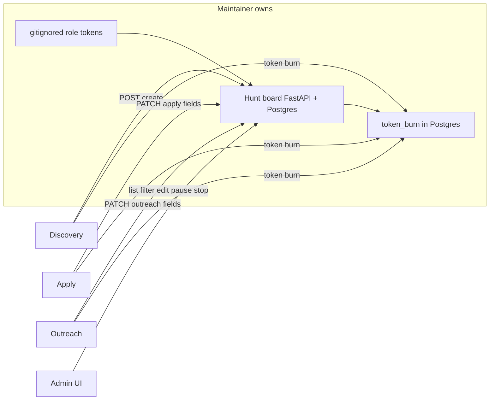
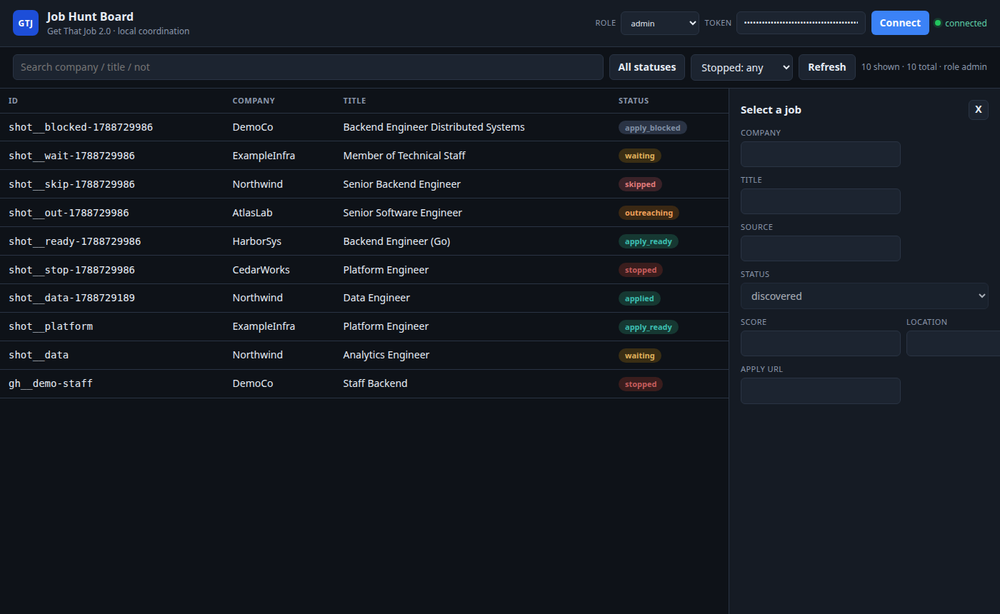
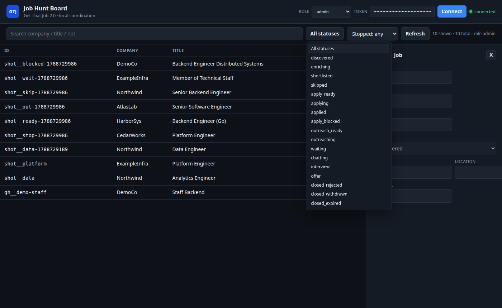
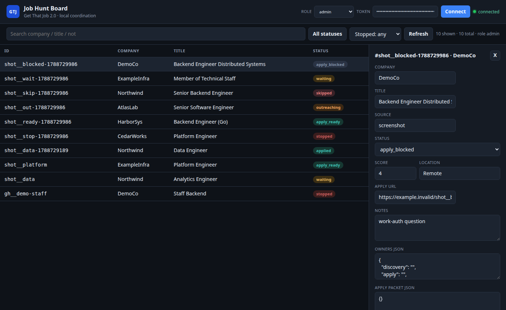

# jobOS Hub

Private **live coordination plane** for a multi-agent job hunt. FastAPI + PostgreSQL + an operator web UI.

**jobOS** is a job harness. **Maintainer owns and maintains this Hub** (skill-maintainer / `maintenance` role): process hygiene, token issuance and rotation, uptime, schema, benchmarks, and share/tunnel setup. Discovery, apply, and outreach **consume** it. They do not own it.

Agents: `curl -sS "$HUB_URL/llms.txt"` and `curl -sS "$HUB_URL/agents.txt"`. Do not scrape HTML for protocol.

This is not a git ledger. Canonical state is Postgres + BlobStore. See [Architecture](#architecture) and [`docs/job-hub/multi-tenant.md`](../docs/job-hub/multi-tenant.md).

**Job Hub docs:** operator [`docs/job-hub/human.md`](../docs/job-hub/human.md) (deploy, signup, invites, export); agents [`docs/job-hub/agent.md`](../docs/job-hub/agent.md) (`$HUB_KEY`, join, onboarding, heartbeat, queue, memory). Memory pods: [`docs/job-hub/memory.md`](../docs/job-hub/memory.md). Maintainer owns this process; maintainer is not discovery.

Primary auth is a Hub session cookie (human admin) or Bearer `$HUB_KEY` (`jh_own_` / `jh_agt_`). Compat headers `X-Role` + `X-Token` still list jobs but `GET /api/whoami` returns `compat_deprecated: true`.

The admin UI after **Connect** (or an admin cookie): one shared job list, status pills, filter bar, stats. Open a row to edit, **Pause** (freeze, keep status), or **Stop** (withdraw). Tokens stay in the header password field and are never committed. Operator data tables for people / candidate / registry / memory live on the Hub admin pages.

## Architecture

We run the hunt on **one shared board**, not a Sheet or CSV mirror.

- **Live plane:** this process. Sibling agents read and write through HTTP. Humans use `/login` then `/board`.
- **Export:** `GET /api/export/ledger` writes YAML when you need files. Not dual-write.
- **Owner:** maintainer. Starts the process, schema, uptime. Discovery/apply/outreach consume it.
- **Auth:** username + password session, or Hub Bearer `$HUB_KEY`. Compat `X-Role` + `X-Token` maps to a reserved `acc_compat` tenant and is deprecated.
- **Tenancy:** every row is namespaced by `account_id`. Queue routing is `{account_id}.{kind}`.
- **Lanes:** discovery **creates** the card and may finish discovery-owned fields while the job is still in the discovery lane. Apply **advances** apply fields only. Outreach **advances** outreach fields only. Admin can pause, stop, edit, or delete.
- **Share:** default `http://127.0.0.1:8787/` on the hunt machine (server binds `0.0.0.0`). Optional temporary tunnel — see [How to share](#how-to-share-with-humans).



Status enum is the Job Apply OS contract (`discovered` → … → `offer` / `closed_*`). Bind address is `0.0.0.0` so sibling agents on this host can reach it.

## UI walkthrough (admin)

Use these steps on `http://127.0.0.1:8787/`. Create an account at `/login` (username + password). No dashboard token. Optional screenshot refresh: `bash board/scripts/capture_readme_shots.sh` (writes under `board/docs/` when those files exist).

1. **Sign up / log in.** Open `/`, then `/login`. Create a username. You land on `/onboarding` until a truthful candidate exists, then `/board`. **Home** (`/home`) is the funnel dashboard: found → applied → outreached, agent load, today counts, oldest open job.

2. **List.** Columns are company, title, status, score, pay, posted date, claim. Search matches company / title / id / URL / notes / description. Extra filters: lane, apply kind, score, remote, pay stated, location, source. The list is paginated (25/50/100). Stats on the right show shown / matched / total.

   

3. **Filter.** **All statuses** opens the full jobOS enum (`discovered` → `offer` / `closed_*`). **Stopped: any** can hide paused/stopped rows or show only those.

   

4. **Open a job.** Click a row — the ticket is hidden until then. The side panel title becomes `#id · company`. Identity fields (company, title, source, status, score, location, apply URL, posted date, pay, description, expectations) sit at the top; packets, proof, events, Pause / Stop / Resume / Delete are below.

   

5. **Edit.** Change fields the connected role is allowed to patch, then **Save patch**. Admin can edit anything. Discovery cannot save apply/outreach fields. Apply cannot change company/title/URL. Outreach cannot rewrite identity.

6. **Pause / Stop.** **Pause** freezes the row and keeps the current status (lanes get 409 until **Resume**). **Stop** sets `closed_withdrawn`, records a reason, and freezes. Both require admin. **Resume** clears the freeze. **Delete** is admin-only and is not the default.

What each role sees vs admin:

| Action | discovery | apply | outreach | maintenance | admin |
| --- | --- | --- | --- | --- | --- |
| See list / events | yes | yes | yes | yes | yes |
| Create row | yes | no | no | no | yes |
| Patch own lane | discovery lane only | apply fields | outreach fields | no | all |
| Pause / Stop / Resume / Delete | no | no | no | no | yes |
| Hygiene / import / metrics summary | no | no | no | yes | yes |
| Log token burn | yes | yes | yes | yes | yes |

Side panel on an open job: packets, events, Pause / Stop / Resume. Discovery/apply/outreach connecting here can read the same row but their Save button only sends fields their role may patch.

## Board vs export

| Plane | What it is | When |
| --- | --- | --- |
| **This board** | Live private UI + API. PostgreSQL + RabbitMQ + BlobStore. | Production. Multi-tenant. |
| **Export tarball** | `GET /api/export/ledger` YAML snapshot | Airgap copy. Not the live list. |

Do not write live jobs into git `ledger/`. Maintainer may import a snapshot (`scripts/board_import_ledger.py`) into a tenant.

## Secrets (no tokens in git)

Tokens are **not** in this repo. On first start, or via the generator, the maintainer creates cryptographically random per-role tokens in gitignored files:

- `board/.env`
- `board/tokens.local.json`

Placeholders only: [`board/.env.example`](.env.example).

```bash
# first time / empty tokens
uv run scripts/board_gen_tokens.py --print

# rotate one role (invalidates that bot’s old token)
uv run scripts/board_gen_tokens.py --rotate apply --print

# rotate everyone
uv run scripts/board_gen_tokens.py --rotate-all --print
```

Give each bot **only** its role token, out of band (not in the codebase, not in group chat). Root `.env` may hold `BOARD_URL` + `BOARD_ROLE` + `BOARD_TOKEN` locally; those files are gitignored.

## Start

```bash
bash scripts/hub_deploy.sh
# or interactive (asks for public host if unset)
bash board/start.sh
# Docker plain (port 8787):
docker compose -f docker-compose.plain.yml up -d --build
# Docker + Traefik on :80 / :443, board at /
HUB_PUBLIC_HOST=12.234.244.34 bash scripts/hub_docker.sh
```

Install guide: [`docs/install.md`](../docs/install.md). After admin signup, **`/onboarding` is required** before invites or agents. A2A cards: `/.well-known/agent-card.json`.

Listens on `http://0.0.0.0:8787` inside the process (override `BOARD_HOST` / `BOARD_PORT`). Traefik publishes **80** and **443** and routes `/` to the board. First start generates compat role tokens **and** a one-time `jh_boot_*` admin bootstrap token if no admin user exists. Signup URL is printed to stdout. Set `HUB_PUBLIC_HOST` (hostname, IP, or `IP:port`) or `HUB_PUBLIC_URL` for invite origins.

After the first `POST /api/auth/bootstrap`, signup is closed: `/admin/signup` redirects to `/login`, the bootstrap token is wiped, and a second signup 403s. `GET /health` includes `admin_bootstrapped` (no secrets). Existing `X-Role` + `X-Token` job APIs stay valid (compat).

```bash
make -C board test          # API + token generator tests
uv run board/scripts/benchmark.py
bash board/scripts/capture_readme_shots.sh   # refresh docs/*.png from a live UI
```

## How each role uses it

Set `BOARD_URL` (example `http://127.0.0.1:8787`). Never put the token in a command you will paste into git.

```bash
export BOARD_URL=http://127.0.0.1:8787
# token lives in the environment, issued by maintainer
```

### Discovery (create)

```bash
curl -sS "$BOARD_URL/api/jobs" \
  -H "X-Role: discovery" \
  -H "X-Token: $BOARD_TOKEN_DISCOVERY" \
  -H "X-Actor: discovery-1" \
  -H "Content-Type: application/json" \
  -d '{
    "id": "remoteok__123",
    "company": "ExampleCo",
    "title": "Staff Backend Engineer",
    "apply_url": "https://boards.greenhouse.io/exampleco/jobs/123",
    "sources": ["remoteok"],
    "status": "apply_ready",
    "score": 4,
    "owners": {"discovery": "discovery-1"},
    "apply_packet": {"url": "https://boards.greenhouse.io/exampleco/jobs/123", "steps": ["Open apply_url"]}
  }'
```

Duplicates (same `apply_url`, or same company+title+location) return **409**.

### Apply (patch apply fields)

```bash
curl -sS -X PATCH "$BOARD_URL/api/jobs/remoteok__123" \
  -H "X-Role: apply" \
  -H "X-Token: $BOARD_TOKEN_APPLY" \
  -H "Content-Type: application/json" \
  -d '{
    "status": "applied",
    "owners": {"apply": "apply-1"},
    "proof": {"submitted_at": "2026-09-06T18:00:00Z", "confirmation": "thank-you page"}
  }'
```

### Outreach (patch outreach fields)

```bash
curl -sS -X PATCH "$BOARD_URL/api/jobs/remoteok__123" \
  -H "X-Role: outreach" \
  -H "X-Token: $BOARD_TOKEN_OUTREACH" \
  -H "Content-Type: application/json" \
  -d '{
    "status": "waiting",
    "owners": {"outreach": "outreach-1"},
    "outreach_packet": {"ask": "15-minute chat", "people": []}
  }'
```

### Maintenance (read + hygiene, no create)

```bash
curl -sS "$BOARD_URL/api/jobs" -H "X-Role: maintenance" -H "X-Token: $BOARD_TOKEN_MAINTENANCE"
curl -sS "$BOARD_URL/api/hygiene" -H "X-Role: maintenance" -H "X-Token: $BOARD_TOKEN_MAINTENANCE"
curl -sS "$BOARD_URL/api/metrics/summary" -H "X-Role: maintenance" -H "X-Token: $BOARD_TOKEN_MAINTENANCE"
```

### Admin UI (list / filter / edit / pause / stop)

Open `http://127.0.0.1:8787/` as **admin**. See [UI walkthrough](#ui-walkthrough-admin). Header: Role + Token + **Connect**.

```bash
curl -sS -X POST "$BOARD_URL/api/jobs/remoteok__123/pause" \
  -H "X-Role: admin" -H "X-Token: $BOARD_TOKEN_ADMIN" \
  -H "Content-Type: application/json" \
  -d '{"reason":"wait for human on work-auth"}'

curl -sS -X POST "$BOARD_URL/api/jobs/remoteok__123/stop" \
  -H "X-Role: admin" -H "X-Token: $BOARD_TOKEN_ADMIN" \
  -H "Content-Type: application/json" \
  -d '{"reason":"duplicate; keep greenhouse__123"}'
```

Paused or stopped jobs cannot be patched except by admin. Resume with `POST /api/jobs/{id}/resume`.

## Benchmarks and token burn

Maintainer measures board efficiency and skill token burn. Full notes: [`BENCHMARKS.md`](BENCHMARKS.md).

```bash
uv run board/scripts/benchmark.py
uv run board/scripts/benchmark.py --url http://127.0.0.1:8787
```

Agents should log model/tool usage so we can improve the system (swap expensive tools, see which lane burns tokens):

```bash
curl -sS "$BOARD_URL/api/metrics/token_burn" \
  -H "X-Role: discovery" -H "X-Token: $BOARD_TOKEN_DISCOVERY" \
  -H "Content-Type: application/json" \
  -d '{
    "tool_name": "exa-mcp",
    "skill": "discovery",
    "prompt_tokens": 1200,
    "completion_tokens": 400,
    "duration_ms": 1800,
    "job_id": "remoteok__123"
  }'
```

Any authenticated role may POST. Summaries (`GET /api/metrics/summary`) are admin/maintenance. Storage is the Hub PostgreSQL `token_burn` table.

## Maintainer runbook

1. Claim `maintainer` on `ledger/INDEX.md`.
2. `bash scripts/hub_deploy.sh` (or `bash board/start.sh`). Generates compat role tokens and a one-time bootstrap token on first run.
3. Issue each bot its token from `board/.env` / `--print`. Do not commit that file.
4. Optional: import git history  
   `uv run scripts/board_import_ledger.py --db board/data/board.db`  
   (`DATABASE_URL` selects Postgres; `--db` is only a schema key in tests)  
   (skips `_example.yaml`; no resume PDFs).
5. Keep the process up. Rotate a token if a bot leaks it (`--rotate ROLE`).
6. Periodically: `uv run board/scripts/benchmark.py --url http://127.0.0.1:8787` and read [`BENCHMARKS.md`](BENCHMARKS.md).
7. Schema lives in `board/app/db.py` + `board/app/constants.py`. Statuses must stay aligned with `ledger/schema/job.schema.json`.

## How to share with humans

- **Default:** on the shared hunt machine, open `http://127.0.0.1:8787/` (or `http://<host-ip>:8787/` from a sibling agent). Admin login required for the UI.
- **Sibling agents** on the same host: `BOARD_URL=http://<host>:8787` plus that agent’s role token. The server binds `0.0.0.0` for this.
- **Optional temporary public tunnel** (`localtunnel`, `cloudflared`, etc.): maintainer-only. A tunnel **exposes the board to the network**. Keep admin auth on. Prefer a random URL, short TTL, and tear it down after the review. Do not put tokens in the tunnel URL.
- **Group chats cannot host connect cards**, login widgets, or live board iframes. Paste a URL if you must; send tokens in a private channel, never in the chat.

## API surface

| Method | Path | Who |
| --- | --- | --- |
| GET | `/health` `/ready` | public (no secrets; `admin_bootstrapped` bool) |
| GET | `/` | Board UI (compat role token in the browser, not in git) |
| GET | `/admin/signup` | one-time admin bootstrap form |
| GET | `/login` `/admin/invites` `/admin/users` `/join/{id}` | login + invite UI + presence directory; join is public with `?s=` |
| POST | `/api/auth/bootstrap` | bootstrap token → first admin (cookie) |
| POST | `/api/auth/login` `/api/auth/logout` | session cookie `hub_session` (12h idle) |
| GET | `/api/auth/me` | session, Bearer, X-Hub-Key, or compat headers |
| POST/GET | `/api/invites` | admin: create (secret once) / list (no secrets) |
| POST | `/api/invites/{id}/revoke` | admin |
| GET | `/api/join/{id}?s=` | invite signup payload (no pack zip yet) |
| POST | `/api/auth/join` | owner or agent + one-time `jh_own_*` / `jh_agt_*` |
| POST | `/api/agents` `/api/agents/{id}/rotate_key` `/disable` | owner or admin |
| POST | `/api/presence/heartbeat` | session, Bearer, or Connect token; optional (any API action already counts) |
| GET | `/api/presence` | admin, maintenance; owners see own track. No API keys. |
| GET | `/api/users` | admin directory including disabled. No API keys. |
| GET | `/home` `/api/dashboard` | operator funnel (found/applied/outreached), agent load, today + oldest pipeline |
| GET | `/api/whoami` `/api/meta` `/api/jobs` `/api/jobs/{id}` `/api/events` | any valid role / key. `GET /api/jobs` omit `limit` for the full list; board UI uses `limit`/`offset` plus lane/kind/score/remote/pay/location/source filters |
| POST | `/api/jobs` | discovery, admin |
| PATCH | `/api/jobs/{id}` | discovery (lane only), apply, outreach, admin |
| POST | `/api/jobs/{id}/pause` `/resume` `/stop` | admin |
| DELETE | `/api/jobs/{id}` | admin |
| GET | `/api/hygiene` | admin, maintenance |
| POST | `/api/hygiene/vacuum` | admin, maintenance |
| POST | `/api/import` | admin, maintenance (`replace` is admin-only) |
| GET | `/api/export/ledger` | admin, maintenance — yaml+jsonl tarball or `?format=json`; strips tokens |
| GET/POST/PATCH | `/api/people` `/api/people/{id}` | outreach, admin — hiring contacts, no secrets |
| GET | `/onboarding` | candidate wizard (mandatory after admin signup) |
| GET | `/api/candidate/status` `/api/candidate/template` | public status; template is admin |
| GET/PUT | `/api/candidate` | admin YAML/JSON; stored next to sqlite, never git |
| GET | `/api/candidate/public` | any user — `{present:false}` until admin supplies yaml |
| GET/PUT | `/api/candidate/resume` | GET: apply, outreach, admin. PUT: admin |
| GET | `/.well-known/agent-card.json` `/a2a/{track}/agent-card.json` | public A2A Agent Cards |
| POST | `/a2a` `/a2a/{track}` | JSON-RPC `message/send` (Bearer). Writes Hub inbox |
| GET/POST | `/api/a2a/directory` `/api/a2a/peers` | local cards + federated peers |
| POST | `/api/metrics/token_burn` | any authenticated role |
| GET | `/api/metrics/token_burn` `/api/metrics/summary` | admin, maintenance |

## Layout

```
board/
  README.md
  BENCHMARKS.md
  start.sh
  Makefile
  docs/                 README screenshots: 01-dashboard, 02-filters, 03-detail
  scripts/benchmark.py
  scripts/capture_readme_shots.sh
  app/                  FastAPI app
  data/                 SQLite + metrics (gitignored *.db *.jsonl)
  tests/
```
