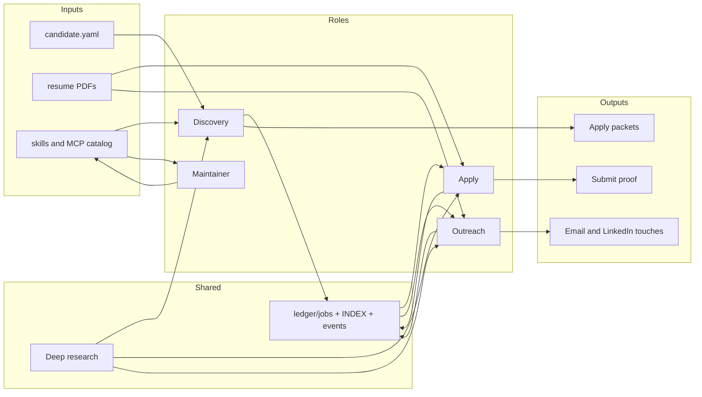
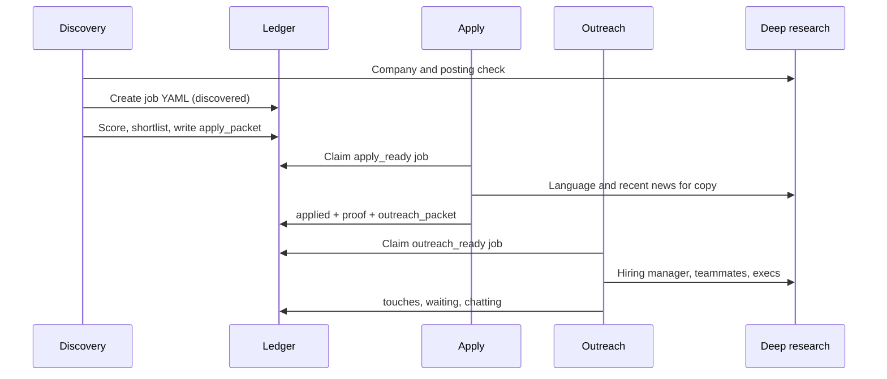

# Architecture

Job Apply OS is a **multi-agent workflow with a file-backed bus**. There is no required server. The repo is the coordination plane.

## Goals

- One discovery lane that only finds and shortlists.
- One apply lane that only submits from a packet, with writing that is worth reading.
- One outreach lane that only emails and LinkedIn-DMs after a handoff.
- A shared live list that airgapped bots can still update.
- Skills and MCPs that are discovered, vetted, listed, and maintained — not hardcoded forever.

## Components



### Candidate profile

Single file: `profiles/candidate.yaml`. Every role reads it. Nobody keeps a private fork of the target titles or deal-breakers unless they write the change back.

### Skill and MCP catalog

Not a vendor lock. Discovery searches public registries at the start of a cycle. The seldom-used **maintainer** writes the machine-readable lists in [`skills/lists/`](../skills/lists/) and keeps `docs/catalogs/skills-and-mcps.md` honest. See [`skill-and-mcp-catalog`](../skills/skill-and-mcp-catalog/SKILL.md) and [`skill-maintainer`](../skills/skill-maintainer/SKILL.md).

### Deep research

A shared capability, not a fourth owner. Used to:

- Verify a posting is real and current
- Map the team and likely hiring manager
- Pull company language for apply copy
- Find emails and LinkedIn URLs for outreach

Preferred MCP: Exa. Local fallback the cloud agent can run: [dzhng/deep-research](https://github.com/dzhng/deep-research) via `scripts/run_deep_research.py` (Firecrawl + OpenAI). Other fallbacks: Firecrawl MCP, Tavily, Parallel Search MCP, built-in search. See [`docs/catalogs/deep-research.md`](catalogs/deep-research.md). Build plan: [`docs/research/platform-mcp-build-plan.md`](research/platform-mcp-build-plan.md).

The **maintainer** owner is for the skill tree, not for company research.

### Ledger

Source of truth for jobs, people, and events. Git is the sync protocol. Optional Drive/Sheet is a mirror owned by discovery. See [`sharing.md`](sharing.md).

## Data flow for one job



## Packet design

Chat history is not a handoff. Packets are.

| Packet | Produced by | Consumed by | Must contain |
| --- | --- | --- | --- |
| `apply_packet` | Discovery | Apply | URL, ATS, account, steps, materials, known questions, why shortlisted |
| `outreach_packet` | Apply (seed) + Outreach (fill) | Outreach | Who to contact, why, resume file, one-line hook, do-not-contact |

Templates live in [`handoffs/`](../handoffs/).

## Subdivision

A role is a **permission set**, not a process count.

```
Discovery
  ├─ boards (LinkedIn, Indeed, Wellfound, YC, RemoteOK, Hiring Cafe, Weekday, Google dorks)
  ├─ marketplaces (Toptal, Lemon.io, Flexiple, Turing, BairesDev)
  └─ big-tech careers (Amazon, Microsoft, Google, Uber, ...)

Apply
  ├─ greenhouse / lever / ashby
  ├─ workday / greenhouse-adjacent
  └─ linkedin easy apply (only after packet)

Outreach
  ├─ email (PDF attached)
  └─ linkedin_dm (ask for a chat)

Maintainer (seldom, repo-wide)
  └─ skills/lists + catalog + mcp.example.json
```

Each subdivision still writes the same job file. If two discovery bots find the same posting, they merge onto one `id` (see sharing rules).

## Runtime topologies

**One bot, all roles.** Allowed. Must still obey the order and the forbidden actions per phase.

**Three bots, three roles.** Default. Discovery owns the ledger portal.

**Many bots.** Split by portal or channel. Claim work in the job YAML (`owners.discovery`, `owners.apply`, `owners.outreach`) before mutating.

**Maintainer bot (rare).** Separate turn. Writes lists. Does not search jobs.

## What we deliberately do not build in v1

- A hosted dashboard
- A scraper farm
- Auto Easy Apply from discovery
- SMS / WhatsApp
- A shared database

Those can be added later if the ledger protocol is stable. The ledger protocol is the product.
