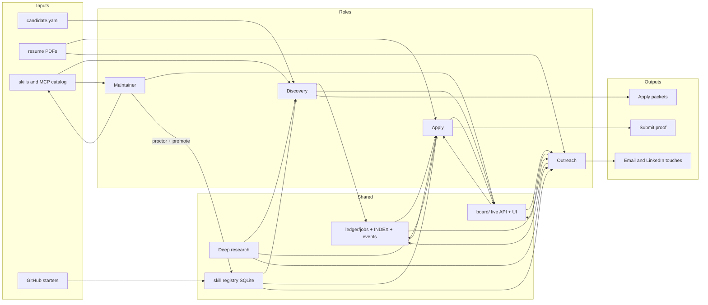
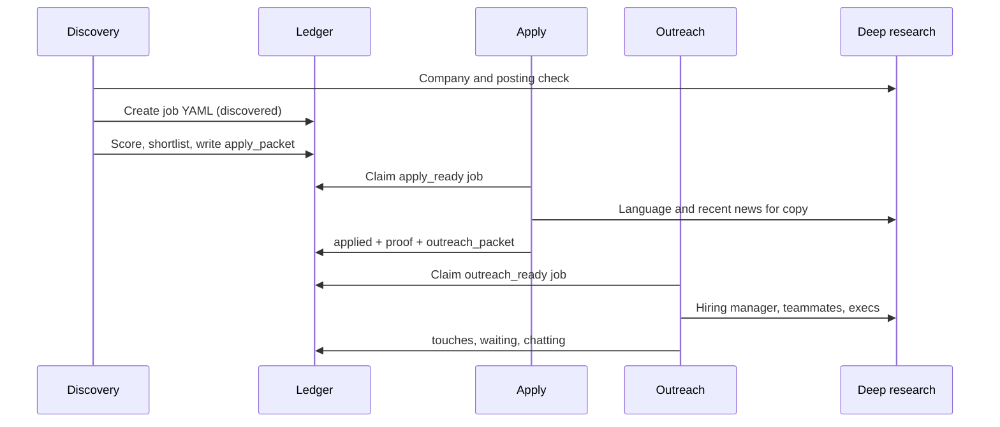

# Architecture

Job Apply OS is a **multi-agent workflow with a file-backed bus**. The repo is the airgap coordination plane. When a hunt has a shared machine, maintainer also runs an optional live board (`board/`) as the practical overlay. The git ledger is not deleted.

## Goals

- One discovery lane that only finds and shortlists.
- One apply lane that only submits from a packet, with writing that is worth reading.
- One outreach lane that only emails and LinkedIn-DMs after a handoff.
- A shared live list that airgapped bots can still update (git), plus an optional maintainer-owned hunt board when agents share a host.
- Skills are **dynamic Hub registry records** (GitHub starters seed them), not hardcoded forever. Local mutations stay on the owning bot. Shared updates require maintainer proctor.
- MCP/tool inventory is discovered, vetted, listed in `skills/lists/`, and maintained.

## Components



### Candidate profile

Single file: `profiles/candidate.yaml`. Every role reads it. Nobody keeps a private fork of the target titles or deal-breakers unless they write the change back.

### Skill and MCP catalog

Not a vendor lock. Discovery searches public registries at the start of a cycle. The seldom-used **maintainer** writes the machine-readable lists in [`skills/lists/`](../skills/lists/) and keeps `docs/catalogs/skills-and-mcps.md` honest. See [`skill-and-mcp-catalog`](../skills/skill-and-mcp-catalog/SKILL.md) and [`skill-maintainer`](../skills/skill-maintainer/SKILL.md).

### Skill registry (Hub)

When `HUB_URL` is set, tagged playbooks live in SQLite (`skills` table), not as a second git source of truth. GitHub `skills/starters/` plus role `SKILL.md` seed `scope=shared` `origin=github` on boot / pack rebuild. Contract: [`docs/catalogs/skill-outline.md`](catalogs/skill-outline.md). Schema: [`ledger/schema/skill.schema.json`](../ledger/schema/skill.schema.json).

- **Shared** (`scope=shared`, `status=approved`): every bot on that role.
- **Local** (`scope=local`): the owning bot only. Worker mutations stay local.
- **Recordings** (`skill_recordings` + queue `skill.record`): any track may push; only maintainer / admin consume, proctor, then promote.

The catalog lists MCP/tools; the registry is the live skill body. Hub **memory pods** are the working set (`docs/job-hub/memory.md`). Track/common facts that should last become skills via `POST /api/memory/items/{id}/solidify` (`origin=memory`), then the same maintainer proctor/promote path. Private worker notes never solidify.

Airgapped bots still load `skills/`. Do not use another bot’s local skill.

### Deep research

A shared capability, not a fourth owner. Used to:

- Verify a posting is real and current
- Map the team and likely hiring manager
- Pull company language for apply copy
- Find emails and LinkedIn URLs for outreach

Preferred MCP: Exa. Local fallback the cloud agent can run: [dzhng/deep-research](https://github.com/dzhng/deep-research) via `scripts/run_deep_research.py` (Firecrawl + OpenAI). Other fallbacks: Firecrawl MCP, Tavily, Parallel Search MCP, built-in search. See [`docs/catalogs/deep-research.md`](catalogs/deep-research.md). Build plan: [`docs/research/platform-mcp-build-plan.md`](research/platform-mcp-build-plan.md).

The **maintainer** owner is for the skill tree, the Hub registry (proctor then promote), **and** the hunt board (tokens, uptime, schema), not for company research.

### Ledger (airgap protocol)

Source of truth for git-based hunts: jobs, people, and events as files. Git is the sync protocol. Optional Drive/Sheet is a mirror owned by discovery. See [`sharing.md`](sharing.md).

### Hunt board (live overlay)

[`board/`](../board/README.md) is a FastAPI + SQLite private board (Job Hub) with Bearer / `X-Hub-Key` owner-agent keys, plus deprecated `X-Role` + `X-Token`. **Maintainer owns it.** Discovery creates rows; apply and outreach only advance their fields; admin can stop or edit. It does not replace the ledger schema. Import history with `scripts/board_import_ledger.py`. Operator/agent docs: [`docs/job-hub/human.md`](job-hub/human.md), [`docs/job-hub/agent.md`](job-hub/agent.md).

**Memory pods** live in the same Hub SQLite (no extra Compose service): per-worker private, per-track shared (discovery / application / outreach / maintenance), plus a common pod. Agents recall every heartbeat and queue claim; writes are gated. Durable track/common facts may be **solidified** into the skill registry. [`docs/job-hub/memory.md`](job-hub/memory.md).

## Data flow for one job



## Packet design

Chat history is not a handoff. Packets are.

| Packet | Produced by | Consumed by | Must contain |
| --- | --- | --- | --- |
| `apply_packet` | Discovery | Apply | URL, ATS, account, steps, materials, known questions, why shortlisted |
| `outreach_packet` | Apply (seed) + Outreach (fill) | Outreach | Who to contact, why, resume file, one-line hook, do-not-contact |

Templates live in [`handoffs/`](../handoffs/).

## Subdivision

A role is a **permission set**, not a process count. Subdivisions are **tagged registry rows** when Hub is up (`GET /api/registry/skills?tag=…`). Airgap: role `SKILL.md` + `skills/starters/`.

```
Discovery
  ├─ source skills (tag=source): LinkedIn, Indeed, Wellfound, YC, RemoteOK, Hiring Cafe, Weekday, Google dorks
  ├─ marketplaces (Toptal, Lemon.io, Flexiple, Turing, BairesDev)
  └─ big-tech careers (Amazon, Microsoft, Google, Uber, ...)

Apply
  ├─ apply skills (tag=apply): greenhouse / lever / ashby
  ├─ workday / greenhouse-adjacent
  └─ linkedin easy apply (only after packet)

Outreach
  ├─ outreach skills (tag=outreach): email (PDF attached)
  └─ linkedin_dm (ask for a chat)

Maintainer (seldom, repo-wide)
  ├─ skills/lists + catalog + mcp.example.json
  ├─ Hub registry: seed starters, claim skill.record, proctor, promote
  └─ hunt board (board/): tokens, schema, uptime, hygiene, tunnels
```

Each subdivision still writes the same job file. If two discovery bots find the same posting, they merge onto one `id` (see sharing rules). Local mutations are `scope=local` on the same role, not a new owner.

## Runtime topologies

**One bot, all roles.** Allowed. Must still obey the order and the forbidden actions per phase.

**Three bots, three roles.** Default. Discovery owns the ledger portal.

**Many bots.** Split by portal or channel. Claim work in the job YAML (`owners.discovery`, `owners.apply`, `owners.outreach`) before mutating.

**Maintainer bot (rare).** Separate turn. Writes lists. Owns the hunt board. Claims `skill.record`, proctors, promotes. Does not search jobs. Worker mutations stay `scope=local` until then.

## What we deliberately do not build into the airgap protocol

- A required hosted dashboard (the git ledger must work with no server)
- A scraper farm
- Auto Easy Apply from discovery
- SMS / WhatsApp

The optional **hunt board** in `board/` is maintainer-owned live infra for a shared host. It is an overlay, not a substitute for `ledger/`. Tokens stay gitignored. The ledger protocol remains the product for airgapped bots.
