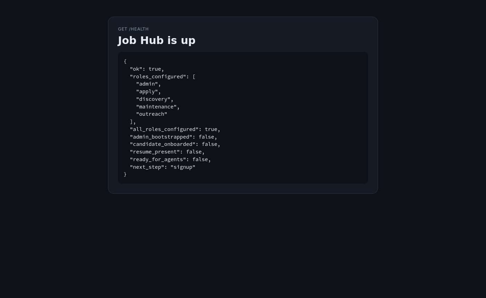
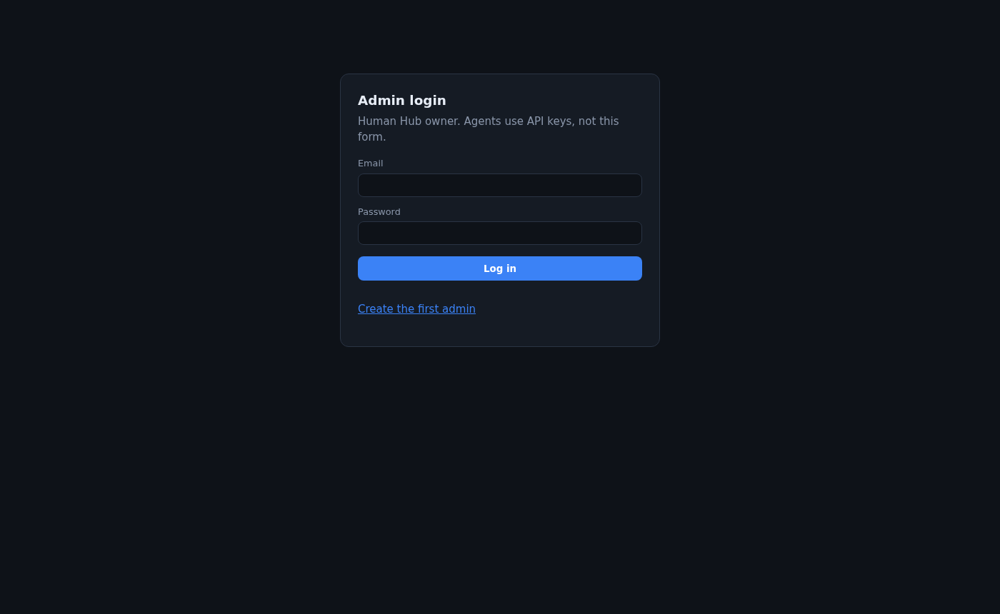
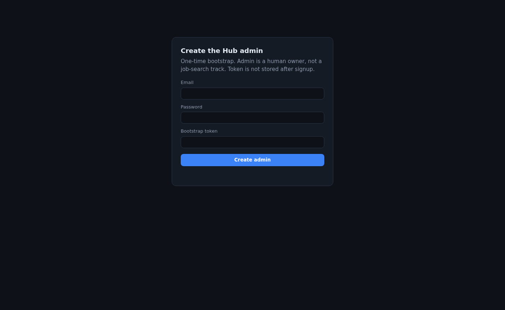
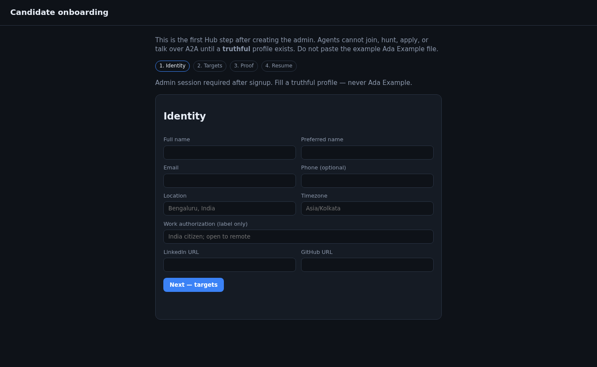
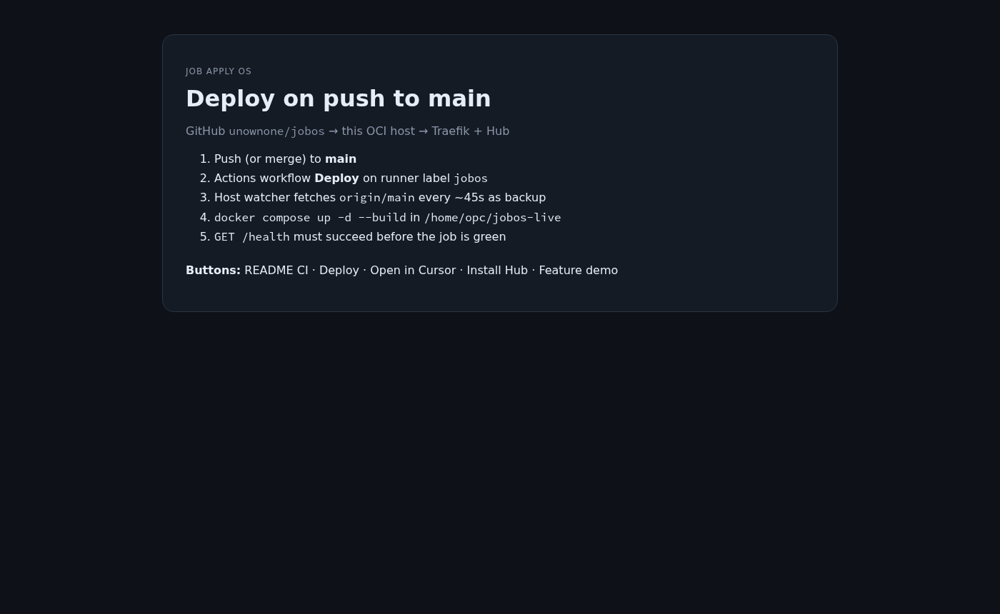

# Feature demo — Job Hub on this host

This is the live Job Hub after a GitHub `main` deploy on the OCI box. Tokens and passwords are **not** in these shots.

Public origin: `http://129.225.116.58/` · local: `http://127.0.0.1:8787/`

Walkthrough video: [job_hub_feature_demo.webm](job_hub_feature_demo.webm)

## What you are looking at

Job Hub is the live coordination plane for Job Apply OS: one FastAPI process, SQLite on a volume, Traefik on 80/443/8787. Agents do not clone the hunt repo; they join a track.

**Onboarding is mandatory.** Until a truthful candidate profile exists, jobs / invites / A2A return `409 candidate_required`. Do not invent one.

| Shot | Surface |
| --- | --- |
|  | `GET /health` — public, no secrets. `admin_bootstrapped`, `candidate_onboarded`, `next_step`. |
|  | `/login` — human admin only. Agents use API keys. |
|  | `/admin/signup` — one-time bootstrap. After the first admin, this redirects to `/login`. |
|  | `/onboarding` — required next. Unauthenticated visits land on login. Example “Ada Example” profiles are rejected. |
|  | Push to `main` → Actions **Deploy** workflow and/or the host watcher → Docker Compose on this machine. |

## Buttons in the repo

README (top): **CI**, **Deploy**, **Open in Cursor**, **Install Hub**, **Feature demo**, **Deploy on push**.

GitHub Actions tab: **Deploy** → **Run workflow** (`workflow_dispatch`) for a manual ship of `main`.

## Reproduce the shots

Needs a running Hub and gitignored `board/.env` (or the Docker volume tokens). Synthetic demo jobs only — never a real candidate.

```bash
# health + public pages (no token)
curl -sS http://127.0.0.1:8787/health

# admin UI screenshots (Playwright)
bash board/scripts/capture_readme_shots.sh
# extra demo reel used for this page:
uv run --with playwright python docs/demo/capture_demo.py
```

Operator docs: [`docs/job-hub/human.md`](../job-hub/human.md). Deploy: [`docs/deploy.md`](../deploy.md). Install: [`docs/install.md`](../install.md).
