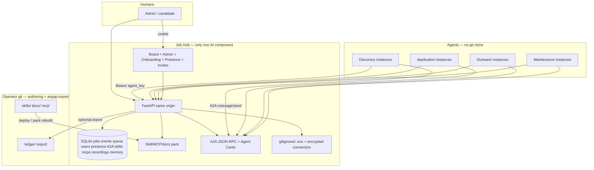

# Job Hub target architecture

Grows **`board/`** (FastAPI + SQLite + admin UI) into the Hub. Consumers do not clone the hunt repo. Role playbooks are authored in git and served as a pack. Tagged skills live in the Hub **registry** (seeded from `skills/starters/`). Git is the starter copy; SQLite is the live copy.

Related: [grilling](01-grilling.md), [PR plan](03-pr-plan.md), current overlay [board/README.md](../../board/README.md).

## Components



| Component | v1 choice |
| --- | --- |
| HTTP | Gunicorn + Uvicorn workers, FastAPI `board/app/main.py` |
| DB | SQLite WAL (`board/data/board.db` extended) |
| Queue | Table `queue_items` + row locks; not Redis |
| Pack | Files under `board/data/packs/<sha>/` |
| UI | Extend `board/app/static/index.html` (or split `admin.html` if the file gets large) |
| Deploy | `scripts/hub_deploy.sh`; Docker Compose plain (`docker-compose.plain.yml`) or Traefik (`docker-compose.yml`). See [`docs/install.md`](../install.md). |

## Identity and tracks

```
admin (human)
  └── invites
        └── track owner (bot)
              └── agent users (bot instances)

tracks: discovery | application | outreach | maintenance
```

Process role names `apply` / `maintainer` are aliases in code (`TRACK_ALIASES`). Board permission tables keep using discovery/apply/outreach/maintenance/admin internally; API JSON prefers the four track names plus admin.

## Data model (SQLite)

Keep `jobs` and `events` as today. Add:

### `users`

| Column | Notes |
| --- | --- |
| `id` | `usr_` + ulid |
| `kind` | `admin` \| `viewer` \| `owner` \| `agent` |
| `track` | null for admin/viewer |
| `email` | humans only |
| `password_hash` | humans only |
| `display_name` | unique per track |
| `metadata_json` | model, harness, bed, extra |
| `created_by` | admin or owner id |
| `disabled_at` | |

### `api_keys`

`id`, `user_id`, `prefix` (for display `jh_agt_…abcd`), `key_hash`, `created_at`, `revoked_at`. Plaintext shown once.

### `invites`

`id`, `track`, `mode`, `secret_hash`, `max_redemptions`, `redemptions`, `expires_at`, `revoked_at`, `created_by`.

### `sessions`

`id`, `user_id`, `token_hash`, `expires_at`, `last_seen`.

### `presence`

`user_id` PK, `status`, `last_heartbeat`, `task_id`, `producing_at`, `user_agent`.

### `queue_items`

`id`, `kind`, `track`, `job_id` nullable, `payload_json`, `status` (`open`\|`claimed`\|`acked`\|`dead`), `claimed_by`, `lease_until`, `attempts`, `dedupe_key` UNIQUE, `created_at`.

### `messages`

`id`, `from_user_id`, `to_user_id` nullable, `to_track` nullable, `job_id`, `type`, `body`, `created_at`, `read_at`. Also mirrored as `queue_items.kind=message` **or** only this table + poll; **v1: `messages` table + `GET /api/messages?unread=1`**. Queue claim is for **work**, not chat. Messaging phase may enqueue a lightweight `message.notify` if we want claim-style wakes — default is poll 10s on the heartbeat response (`pending_messages`).

### `connectors`

`id`, `provider`, `created_by_admin`, `blob_encrypted`, `status`. Never exported to ledger.

### `packs`

`sha`, `git_sha`, `built_at`, `path`, `catalog_updated_at`.

### `jobs` additions

Optional `claim_user_id`, `claim_lease_until` for the **active lane claim** (mirrors queue). `owners` JSON stays (`discovery`/`apply`/`outreach` keys — keep `apply` in the job document for schema compatibility).

### `skills` (Hub registry)

Live playbooks. GitHub starters seed `scope=shared` `status=approved` `origin=github`. Contract: [`docs/catalogs/skill-outline.md`](../catalogs/skill-outline.md). Schema: [`ledger/schema/skill.schema.json`](../../ledger/schema/skill.schema.json).

| Column | Notes |
| --- | --- |
| `id` | `skl_` + ulid (compat rows may use `compat:…`) |
| `slug` | stable among shared skills |
| `name` | display |
| `kind` | `skill` \| `mcp` \| `http` \| `builtin` |
| `role` | `discovery` \| `apply` \| `outreach` \| `research` \| `maintain` |
| `tags` | JSON; motion tags `source` \| `apply` \| `outreach` \| `research` \| `maintain` plus platform |
| `scope` | `shared` \| `local` |
| `owner_user_id` | null for shared; owning bot for local |
| `status` | `draft` \| `recorded` \| `proctoring` \| `approved` \| `rejected` \| `retired` |
| `platform` | platform catalog id or ATS name |
| `match_json` | `ats`, `url_patterns`, `apply_kind` |
| `reproducible` | boolean |
| `inputs` / `outputs` | JSON arrays of packet field names |
| `body` | markdown playbook |
| `origin` | `github` \| `recording` \| `mutation` \| `memory` |
| `origin_ref` / `parent_skill_id` | |
| `version` / `content_hash` | |
| `proctor_status` | `none` \| `pending` \| `passed` \| `failed` |
| `proctor_note` / `proctor_evidence` | |

Visibility: any user sees **shared approved** + **own local**. Local rows are invisible to other bots.

### `skill_recordings`

Enqueue for maintainer proctor. Any track may insert; only maintenance / admin claim.

| Column | Notes |
| --- | --- |
| `id` | recording id |
| `skill_id` | local or forked skill being submitted |
| `submitter_user_id` | owning bot |
| `origin` | `recording` \| `mutation` \| `memory` |
| `body_snapshot` / `payload_json` | what to proctor |
| `status` | pending / proctoring / passed / failed / promoted |
| `proctor_user_id` / `proctor_note` | maintainer after claim |
| `created_at` | |

Pushing a recording also upserts queue kind `skill.record`.

### `memory_items`

Segmented working memory. **Not** the job ledger.

| Column | Notes |
| --- | --- |
| `pod` | `common` \| `track:{track}` \| `worker:{user_id}` |
| `kind` | Allowlisted per pod (portal_quirk, tool_failure, …) |
| `content_hash` | Dedup inside a pod |
| `expires_at` | Worker notes TTL; low-importance track/common TTL |
| `solidify_status` | `none` \| `queued` \| `passed` \| `failed` \| `promoted` \| `declined` |
| `recording_id` | Set when a track/common fact is solidified into `skill_recordings` |

FTS5 virtual table `memory_fts`. Write caps per 15 minutes: worker 6, track 3, common 2. Heartbeat and queue claim return a compact recall card.

## Queue model

See grilling Q20–Q21. Claim SQL sketch:

```sql
BEGIN IMMEDIATE;
SELECT id FROM queue_items
 WHERE status IN ('open','claimed')
   AND kind IN (:allowed)
   AND (status='open' OR lease_until < :now)
 ORDER BY id
 LIMIT 1;
-- update that id to claimed, lease_until = now+15m, claimed_by = :user
COMMIT;
```

System triggers (in job PATCH/POST):

- status becomes `apply_ready` **and** packet has `url` or `steps` → upsert `apply.ready` (dedupe_key `apply.ready:<job_id>`).
- status `applied` or (`apply_kind` in network/outreach_only and discovery marks `outreach_ready`) → upsert `outreach.ready`.
- Discovery create does **not** enqueue apply.
- `POST /api/registry/recordings` (or `POST /api/queue/push` kind `skill.record`) → upsert `skill.record`. **Produce:** every track. **Consume:** maintenance and admin only.

## UI surfaces

| Surface | Route | Auth |
| --- | --- | --- |
| Board (job list, filters, detail, pause/stop) | `/` | session or pasted key (existing Connect) |
| Admin home | `/admin` | admin session |
| Bootstrap signup | `/admin/signup` | bootstrap token |
| Login | `/login` | public |
| Invites | `/admin/invites` | admin |
| Presence / user directory | `/admin/users` | admin + maintenance |
| Skills registry / proctor | `/admin/skills` | admin + maintenance |
| Join (human-readable) | `/join/{invite_id}` | invite secret |
| Memory inspector | `/admin/memory` | session |
| Health | `/health` | public, no secrets |

Board adds a **presence rail** (who is working) using `GET /api/presence` if the principal may read it (admin, maintenance, owners see own track).

## API catalog

Auth column: `public` | `bootstrap` | `invite` | `admin` | `owner` | `agent` | `track:<name>` | `compat` | `any_user`.

`any_user` = valid session or owner/agent key. Track gates are extra.

### Auth and onboarding

| Method | Path | Auth | Purpose |
| --- | --- | --- | --- |
| POST | `/api/auth/bootstrap` | bootstrap | Create first admin (email, password) |
| POST | `/api/auth/bootstrap/rotate` | admin | New unused bootstrap |
| POST | `/api/auth/login` | public | Session cookie |
| POST | `/api/auth/logout` | any_user | |
| GET | `/api/auth/me` | any_user | Principal, track, capabilities |
| POST | `/api/invites` | admin | Create invite |
| GET | `/api/invites` | admin | List (no secrets) |
| POST | `/api/invites/{id}/revoke` | admin | |
| POST | `/api/auth/join` | invite | Owner or agent signup + metadata; returns API key once |
| POST | `/api/agents` | owner, admin | Mint agent user + key |
| POST | `/api/agents/{id}/rotate_key` | owner, admin, self | |
| POST | `/api/agents/{id}/disable` | owner, admin | |
| GET | `/api/onboarding` | invite or any_user | Pack index + readings + connectors_needed |
| GET | `/api/docs/{path}` | invite or any_user | Raw markdown under allowlist `docs/`, `handoffs/`, `AGENTS.md` |
| GET | `/api/skills/{name}/{file}` | invite or any_user | SKILL.md and references |
| GET | `/api/mcp/example.json` | invite or any_user | |
| GET | `/api/mcp/hosted/{name}.json` | invite or any_user | |
| GET | `/api/scripts/{name}` | invite or any_user | Allowlisted `scripts/*.sh` |
| GET | `/api/packs/current/skills.zip` | invite or any_user | |
| POST | `/api/packs/rebuild` | admin, maintenance | |

### Skill registry

Auth: session, Bearer / `X-Hub-Key`, or compat role token. Unauthenticated → 401. Local skills are owner-only.

| Method | Path | Auth | Purpose |
| --- | --- | --- | --- |
| GET | `/api/registry/skills` | any_user | Shared approved + **own local**. Query `tag`, `role`, `platform`, `ats`, `url`, `scope` |
| GET | `/api/registry/skills/{id}` | any_user | Same visibility |
| GET | `/api/registry/mcps` | any_user | Seeded MCP/tool inventory. Query `status`, `kind`, `role`, `capability`, `platform` |
| GET | `/api/registry/mcps/{id}` | any_user | Id or slug |
| POST | `/api/registry/skills` | any_user | Create **local** draft / mutation |
| PATCH | `/api/registry/skills/{id}` | owner: local only. maintenance/admin: shared | |
| POST | `/api/registry/skills/{id}/fork` | any_user | Copy shared (or own) → new local |
| POST | `/api/registry/recordings` | any_user (every track) | Submit recording; enqueues `skill.record` |
| GET | `/api/registry/recordings` | submitter: own. maintenance/admin: all | |
| POST | `/api/registry/recordings/{id}/proctor` | maintenance, admin | After claim: `pass` \| `fail` |
| POST | `/api/registry/recordings/{id}/promote` | maintenance, admin | Only after pass |
| POST | `/api/registry/seed` | maintenance, admin | Re-seed GitHub starters + MCP lists (does not overwrite promoted non-github shared slugs) |

### Presence and directory

| Method | Path | Auth | Purpose |
| --- | --- | --- | --- |
| POST | `/api/presence/heartbeat` | any_user | 10s ping |
| GET | `/api/presence` | admin, maintenance; owners: own track | Directory |
| GET | `/api/users` | admin | Same + disabled |

### Queue

| Method | Path | Auth | Purpose |
| --- | --- | --- | --- |
| POST | `/api/queue/push` | owner, admin, agent (kinds they may produce) | Explicit tasks (`discovery.search`, messages handled separately) |
| POST | `/api/queue/claim` | agent, owner | Lease work |
| POST | `/api/queue/ack/{id}` | claimant | Complete |
| POST | `/api/queue/nack/{id}` | claimant | Requeue / dead |
| GET | `/api/queue/mine` | any_user | Open claims |
| GET | `/api/queue` | admin, maintenance, owner (track) | Inspect |

### Board (jobs / events) — keep + tighten

| Method | Path | Auth | Purpose |
| --- | --- | --- | --- |
| GET | `/health` | public | |
| GET | `/api/meta` | any_user | statuses, tracks, heartbeat_s |
| GET | `/api/whoami` | any_user | |
| GET | `/api/jobs` | any_user | List/filter |
| GET | `/api/jobs/{id}` | any_user | |
| POST | `/api/jobs` | discovery track, admin | Create; 409 dup |
| PATCH | `/api/jobs/{id}` | lane as today | Field + status gates |
| POST | `/api/jobs/{id}/pause` `/resume` `/stop` | admin | |
| DELETE | `/api/jobs/{id}` | admin | |
| GET | `/api/events` | any_user | |
| GET | `/api/hygiene` | admin, maintenance | |
| POST | `/api/hygiene/vacuum` | admin, maintenance | |
| POST | `/api/import` | admin, maintenance | Ledger JSON |
| GET | `/api/export/ledger` | admin, maintenance | tarball or JSON of yaml+jsonl |
| POST | `/api/metrics/token_burn` | any_user | Keep |
| GET | `/api/metrics/*` | admin, maintenance | Keep |

Compat: `X-Role` + `X-Token` still accepted in phase A–C; phase F logs deprecation; phase H docs tell agents to use Bearer keys.

### People (outreach)

| Method | Path | Auth | Purpose |
| --- | --- | --- | --- |
| GET/POST/PATCH | `/api/people` `/api/people/{id}` | outreach, admin | Mirror `ledger/people` |

v1 minimum: people JSON on the job `outreach_packet` is enough; dedicated people API is **phase F if time**, else F+1. **Default: include people table in F** so export matches ledger.

### Messaging

| Method | Path | Auth | Purpose |
| --- | --- | --- | --- |
| POST | `/api/messages` | any_user | Send (no SMS) |
| GET | `/api/messages` | any_user | Inbox |
| POST | `/api/messages/{id}/read` | recipient | |
| GET | `/.well-known/agent-card.json` | public | A2A Agent Card |
| POST | `/a2a` | Bearer (JSON-RPC) | A2A `message/send` → same inbox |

See [`a2a.md`](a2a.md). Candidate onboarding is required before send.

### Memory pods

See [`memory.md`](memory.md). Same SQLite as the Hub. No extra Compose service.

| Method | Path | Auth | Purpose |
| --- | --- | --- | --- |
| GET | `/api/memory/recall` | any_user | Worker + track + common facts for this round |
| GET | `/api/memory/pods` | any_user | Pods this principal may see |
| GET/POST | `/api/memory/items` | any_user | List / sparse write (gated) |
| PATCH/DELETE | `/api/memory/items/{id}` | author or inspector | Forget / pin / delete |
| POST | `/api/memory/items/{id}/move` | author or inspector | Move or copy onto another pod |
| POST | `/api/memory/items/{id}/solidify` | author or maintainer | Snapshot track/common fact → `skill.record` (`origin=memory`) |
| GET | `/admin/memory` | any_user | Inspector UI |

### Candidate slice

| Method | Path | Auth | Purpose |
| --- | --- | --- | --- |
| GET | `/api/candidate/public` | any_user | Non-secret profile slice |
| PUT | `/api/candidate` | admin | Upload yaml or form; stored gitignored `profiles/candidate.yaml` on server **or** sqlite; never commit |

Resume: `GET /api/candidate/resume` outreach+application+admin; not discovery by default (discovery does not need the PDF). Admin can toggle.

## Permission matrix (Hub)

| Action | discovery | application | outreach | maintenance | admin |
| --- | --- | --- | --- | --- | --- |
| Create job | yes | no | no | no | yes |
| Patch identity | yes in discovery lane | no | no | no | yes |
| Claim apply.ready | no | yes | no | no | steal |
| Claim outreach.ready | no | no | yes | no | steal |
| Easy Apply / submit | no | yes | no | no | no |
| Hygiene / pack | no | no | no | yes | yes |
| Invites | no | no | no | no | yes |
| Mint agents | owner only | owner only | owner only | owner only | yes |
| List registry skills | shared+own local | shared+own local | shared+own local | shared+own local | all |
| See another bot’s local skill | no | no | no | no | no* |
| Push `skill.record` / POST recordings | yes | yes | yes | yes | yes |
| Claim `skill.record` | no | no | no | yes | steal |
| Proctor / promote recording | no | no | no | yes | yes |
| Seed GitHub starters | no | no | no | yes | yes |
| Solidify track/common memory | author | author | author | yes | yes |

\*Admin may inspect for operations; admin does not silently copy another bot’s local body into shared. Promote only after proctor pass.

## Candidate and secrets

This workspace has **no** live `profiles/candidate.yaml`. Hub `/api/candidate/public` returns `{present:false}` until admin supplies one. Do not copy `candidate.example.yaml` into production as if it were real.

## Failure and fallback

| Situation | Behavior |
| --- | --- |
| Hub down | Airgap git if those agents have export files; Cloud agents without git of jobs cannot proceed — `apply_blocked` is not invented |
| Catalog >7d | Block `discovery.search` claims |
| Duplicate job | 409 as today |
| Stale claim | Lease steal + event |
| Missing PDF | outreach ack refused if email kind and no resume bytes |

## Mapping from today’s files

| Today | Hub |
| --- | --- |
| `BOARD_TOKEN_DISCOVERY` | compat; then owner/agent keys |
| `X-Actor` free string | `users.display_name` |
| INDEX Active operators | `GET /api/presence` |
| `owners.apply` on YAML | still on job; plus `claimed_by` on queue |
| `scripts/board_gen_tokens.py` | keep for compat; bootstrap is new |
| `board/start.sh` | called by `hub_deploy.sh` |
