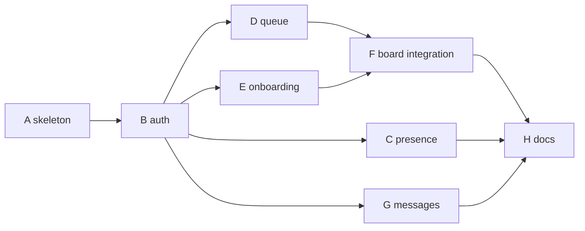

# Job Hub phased PR plan

Each phase is **independently mergeable**, tests green without later phases. Branch pattern: `cursor/<short-name>-be9c` (lowercase). Base: `main`.

Do **not** implement in the spec PR. Sibling agents take one phase each.

**Shared rules for every implementer**

- Read `docs/job-hub/01-grilling.md` + `02-architecture.md` + this file.
- Read `profiles/candidate.yaml`; if missing, do not invent one.
- Claim **maintainer** on `ledger/INDEX.md` without wiping other operators; append `ledger/events.jsonl`.
- Grow `board/`; do not add a second service.
- No secrets in git. No discovery job sourcing. No Easy Apply.
- Keep `ledger/schema/job.schema.json` statuses and job id pattern.
- Tests: pytest under `board/tests/` (extend existing `test_board.py`, `test_tokens.py`).
- After mergeable work: commit, `git push -u origin <branch>`.

**Suggested sequence:** A → B → C and E can parallel after B → D after B (C optional) → F after D → G after B → H last (can draft earlier, merge last).



---

## Phase A — Hub skeleton + deploy + admin bootstrap

- **Branch:** `cursor/hub-skeleton-be9c`
- **Depends on:** spec merged (this doc set)
- **Unblocks:** B

### Files likely touched

- `board/start.sh`, `board/app/main.py`, `board/app/settings.py`, `board/app/db.py`
- `scripts/hub_deploy.sh` (new), `board/.env.example`, `board/docker-compose.yml` (optional, documented)
- `board/tests/test_bootstrap.py` (new)
- `docs/job-hub/` pointer only if needed

### Work

- Deploy script: uv, `board_gen_tokens.py` still for compat role tokens, **plus** `HUB_BOOTSTRAP_TOKEN` if no admin user.
- Print signup URL. Persist bootstrap hash in SQLite; do not implement full invites yet.
- `POST /api/auth/bootstrap` + `/admin/signup` minimal HTML (email, password) **or** JSON-only + one static page.
- After bootstrap: admin session cookie **or** return admin API key for the human (cookie preferred).
- `GET /health` includes `admin_bootstrapped: bool` without leaking tokens.
- Optional compose: one service, volume `board/data`, port 8787.

### Acceptance tests

- Fresh data dir: start script creates bootstrap; health `admin_bootstrapped=false`.
- Bootstrap POST creates admin; second bootstrap fails.
- Signup URL printed to stdout (test via env `HUB_PUBLIC_URL`).
- Existing job list tests still pass (compat tokens).
- `.env` / `tokens.local.json` remain gitignored.

---

## Phase B — Auth: invites, owners, agents, portal login

- **Branch:** `cursor/hub-auth-be9c`
- **Depends on:** A
- **Unblocks:** C, D, E, G

### Files likely touched

- `board/app/auth.py`, `permissions.py`, `main.py`, `db.py`, `static/*.html`
- `board/tests/test_auth_hub.py`
- `board/.env.example` comments for `HUB_DATA_KEY` (unused until connectors)

### Work

- Tables: users, api_keys, invites, sessions.
- Login/logout/me. Invite CRUD (admin). Join endpoint mints owner then agents per grilling Q12.
- `Authorization: Bearer` + `X-Hub-Key`. Map track aliases. Keep `X-Role`/`X-Token` compat.
- Owners `POST /api/agents`. Rotate/disable keys.
- UI: login + invites list with copyable join URL (`HUB_PUBLIC_URL`).
- Principal includes `user_id`, `track`, `kind` for later phases.

### Acceptance tests

- Admin creates discovery invite; join with metadata creates owner + one-time key; second join creates agent until max_redemptions.
- Expired/revoked invite → 410/403.
- Agent key cannot mint agents; owner can.
- Compat role token still lists jobs.
- Application track cannot call create-job (403) even with a valid application key.

---

## Phase C — Heartbeat + presence + admin directory

- **Branch:** `cursor/hub-presence-be9c`
- **Depends on:** B
- **Unblocks:** H (UI copy); F may show rail

### Files likely touched

- `board/app/main.py`, `db.py`, `static/index.html` (presence rail or `/admin/users`)
- `board/tests/test_presence.py`

### Work

- `POST /api/presence/heartbeat` (10s client contract; server `stale_after_s=30`).
- Status derivation per grilling Q16.
- `GET /api/presence` admin/maintenance; owners see own track.
- Admin directory columns: model, harness, bed, role/track, last seen, current task.
- UI pings heartbeat while Connect is active.

### Acceptance tests

- Heartbeat sets `logged_in`; after freeze time in test clock → `stale`.
- Claim field optional in C: if no queue yet, `working` only when heartbeat `status_hint=working` **or** skip `working` until D and document that C implements idle/logged_in/stale/producing-hint only. **Default:** C accepts `task_id` as opaque string so D can hook later.
- Keys never appear in GET presence.
- Unauthenticated heartbeat → 401.

---

## Phase D — Queue + claim/ack + role-scoped pull

- **Branch:** `cursor/hub-queue-be9c`
- **Depends on:** B (C optional)
- **Unblocks:** F (system enqueue on status)

### Files likely touched

- `board/app/db.py`, `main.py`, `permissions.py`, `constants.py`
- `board/tests/test_queue.py`

### Work

- `queue_items` + claim/ack/nack/push/mine.
- Kind allowlists per track (architecture).
- SQLite `BEGIN IMMEDIATE` lease steal after 15m (test with injected `now`).
- Dedupe unique `(kind, job_id)` for job-scoped kinds.
- Discovery cannot claim `apply.*`. Maintenance cannot claim `discovery.search`.
- Optional: on job PATCH to `apply_ready`, enqueue `apply.ready` — **prefer doing this in D** so E/F have something to pull; if PATCH hook is messy, stub `POST /api/queue/push` only and let F add hooks. **Default: D includes system enqueue hooks on job create/patch.**

### Acceptance tests

- Two agents claim two items; same item never double-claimed while lease valid.
- Expired lease: second agent claims; event `claim_expired`.
- Nack requeue; 5th nack → `dead`.
- Apply agent claim of `discovery.search` → 403.
- Status → `apply_ready` creates one `apply.ready` item; duplicate patch does not duplicate (dedupe).

---

## Phase E — Skills/MCP/scripts serving + `/onboarding` + join links

- **Branch:** `cursor/hub-onboarding-be9c`
- **Depends on:** B
- **Unblocks:** H; F uses pack sha in UI optional

### Files likely touched

- `board/app/pack.py` (new), `main.py`
- `board/tests/test_onboarding.py`
- `scripts/hub_build_pack.py` (new) or rebuild inside POST
- Allowlist of paths (no `.env`, no `profiles/candidate.yaml` full file, no `board/data`)

### Work

- Build pack from repo root the server can read.
- `/api/onboarding`, raw skills/docs/scripts, zip, mcp example.
- Track-specific skill lists: discovery gets catalog + discovery + deep-research; application gets job-apply + deep-research; etc. Maintainer gets skill-maintainer + catalog.
- `connectors_needed` static per track (no secret values).
- `candidate.present` false if yaml missing.
- Join HTML page already in B; E fills onboarding JSON completeness.
- Catalog date: read `docs/catalogs/skills-and-mcps.md` “Last catalog pass”; expose `catalog_updated_at`; D/F may use it to block search — **E exposes the field; D/F enforce**. **Default: E enforces GET-only; D if already merged should read pack catalog date when claiming discovery.search.** Coordinate: if D merged first without the field, F wires the gate.

### Acceptance tests

- Unauthenticated onboarding without invite → 401.
- Invite GET onboarding includes `job-discovery` skill URL for discovery track, not apply-only secrets.
- Zip contains `skills/job-apply/SKILL.md` for application track.
- Path traversal `/api/docs/../board/.env` → 404.
- `candidate.present` is false in this workspace.

---

## Phase F — Board API + UI as integration hub

- **Branch:** `cursor/hub-board-api-be9c`
- **Depends on:** D (E recommended)
- **Unblocks:** H

### Files likely touched

- `board/app/main.py`, `permissions.py`, `static/index.html`
- `scripts/board_import_ledger.py`, `scripts/rebuild_index.py` (export path)
- `board/tests/test_board.py` extensions
- People API + table
- `GET /api/export/ledger`

### Work

- UI uses same APIs (already true); add presence rail, show claim holder, hide compat banner if Bearer session.
- People resources; events remain append-only on every job mutation.
- Export writes yaml+jsonl+INDEX to a temp dir or tarball; strips connectors.
- Resume download for apply/outreach/admin only.
- Wire catalog gate: `discovery.search` claim 409 if catalog older than 7 days unless `catalog.refresh` acked.
- Compat deprecation flag on `/api/whoami`.

### Acceptance tests

- Create/patch/list/events still match process lanes.
- Export has no `BOARD_TOKEN` or connector blobs.
- Discovery 403 on Easy Apply status `applied`.
- People round-trip + export file under `people/`.
- UI: still Connect + list + filter + detail (update shot script if selectors change).

---

## Phase G — Inter-agent messaging

- **Branch:** `cursor/hub-messages-be9c`
- **Depends on:** B
- **Unblocks:** H

### Files likely touched

- `board/app/main.py`, `db.py`, `static` optional inbox
- `board/tests/test_messages.py`

### Work

- `POST/GET /api/messages`; types `note|block|handoff|question`.
- Heartbeat response includes `pending_messages` count.
- No SMS/WhatsApp kinds. Reject `channel` fields that imply employer send.
- Admin can read all; agents only theirs + track broadcast.

### Acceptance tests

- Discovery agent messages application track with `job_id`; apply agent sees it.
- Cannot send to arbitrary email address via this API.
- Read receipts.

---

## Phase H — Docs for humans and agents

- **Branch:** `cursor/hub-docs-be9c`
- **Depends on:** A–G as available; can start after A with TODOs replaced by shipped paths
- **Depends on:** none strictly if it only documents the spec; **merge last** so curl examples match

### Files likely touched

- `README.md`, `docs/architecture.md`, `docs/sharing.md`, `board/README.md`, `docs/process.md` (pointer, do not weaken git airgap)
- `docs/job-hub/human.md`, `docs/job-hub/agent.md` (new)
- `AGENTS.md` short “if HUB_URL set, use Hub not git as live list”

### Work

- Human: deploy, signup, create invites, candidate.yaml, resume, connectors, export.
- Agent: curl join, heartbeat loop, claim/ack, onboarding zip install, forbidden column, no repo clone.
- Track-specific one-pagers.

### Acceptance tests

- Doc links resolve in-repo (paths exist).
- No real tokens in examples (`$HUB_KEY`).
- Explicit “maintainer ≠ discovery”.

---

## Non-goals (v1)

- Multi-tenant SaaS (one candidate per Hub deploy)
- OIDC/SSO/MFA
- JWT access tokens
- Redis/Kafka/NATS
- LinkedIn cookie vault / password capture
- SMS, WhatsApp, InMail sequences
- Auto Easy Apply from discovery
- Consumer git clone of the hunt repo
- Dual-write git on every PATCH
- Inventing `profiles/candidate.yaml`
- Scraping authenticated pages without an account
- Replacing skill **authoring** with a Hub CMS
- Mobile apps
- Billing

---

## Implementer handoff prompts

Copy one block per sibling agent. Do not give them this whole grilling unless they need it; they must still open the three docs.

### Prompt A

```
You are a Job Apply OS maintainer implementer. Spec only was merged under docs/job-hub/. Implement PHASE A only (Hub skeleton + deploy script + admin bootstrap). Do not implement invites, queues, or onboarding packs.

Read: profiles/candidate.yaml (do not invent if missing), docs/process.md, docs/roles.md, docs/job-hub/README.md, 01-grilling.md, 02-architecture.md, 03-pr-plan.md Phase A. Claim maintainer on ledger/INDEX.md without wiping others. Append ledger/events.jsonl.

Branch MUST be cursor/hub-skeleton-be9c. Grow board/. Keep existing X-Role/X-Token job APIs green. Add HUB_BOOTSTRAP_TOKEN on first start, POST /api/auth/bootstrap, health.admin_bootstrapped, scripts/hub_deploy.sh. Secrets gitignored.

Acceptance: tests in board/tests for bootstrap once-only; existing board tests pass. No job discovery, no Easy Apply. Commit, push, open PR to main.
```

### Prompt B

```
Implement PHASE B only: Hub auth (admin login, invites, track owners, agent users, Bearer keys). Branch cursor/hub-auth-be9c. Depends on hub skeleton (bootstrap).

Read docs/job-hub/03-pr-plan.md Phase B and architecture API tables. Tracks: discovery|application|outreach|maintenance. Invite URL join + POST /api/auth/join. Owners mint unique agent users. Keep compat BOARD_TOKEN_* .

pytest for invite TTL, max_redemptions, 403 create-job as application track, key rotation. No queues/heartbeats required. Do not invent candidate.yaml. Claim maintainer, events.jsonl, push PR.
```

### Prompt C

```
Implement PHASE C only: 10s heartbeat, presence statuses logged_in|working|idle|producing|stale, admin user directory. Branch cursor/hub-presence-be9c. Depends on auth (users + keys).

Read grilling Q15–Q18. GET /api/presence must not return API keys. UI Connect should heartbeat. Tests with controllable clock for stale_after 30s. No queue implementation. Claim maintainer, no discovery/apply. Push PR.
```

### Prompt D

```
Implement PHASE D only: SQLite queue_items, claim/ack/nack, 15m leases, kind allowlists, dedupe, system enqueue apply.ready / outreach.ready on job status transitions. Branch cursor/hub-queue-be9c. Depends on auth principals with track.

Discovery must 403 on apply.* claims. Two agents must not double-claim. BEGIN IMMEDIATE. Tests in board/tests/test_queue.py. Do not build onboarding zip. Process: no Easy Apply from discovery status writes. Claim maintainer, events.jsonl, PR.
```

### Prompt E

```
Implement PHASE E only: skill/MCP/docs/scripts serving, GET /api/onboarding, skills.zip pack, shareable invite onboarding JSON. Branch cursor/hub-onboarding-be9c. Depends on auth/invites.

Consumers must not need the git repo. Allowlist paths; block .env and candidate.yaml full dump. Track-specific skills. candidate.present false if profiles/candidate.yaml missing. connectors_needed without secrets. Tests for path traversal and zip contents. Claim maintainer, PR.
```

### Prompt F

```
Implement PHASE F only: Board as integration hub — people API, ledger export, catalog 7-day gate on discovery.search, UI presence/claim holders, resume download for apply/outreach/admin, deprecation flag on compat tokens. Branch cursor/hub-board-api-be9c. Depends on queue (D); onboarding catalog_updated_at if E merged.

Keep job.schema.json statuses. Export must strip secrets. Do not delete ledger airgap docs. Existing permission lanes stay. Tests extend test_board.py. Claim maintainer, no sourcing jobs. PR.
```

### Prompt G

```
Implement PHASE G only: inter-agent messaging APIs (note/block/handoff/question), inbox poll, pending_messages on heartbeat if presence exists. Branch cursor/hub-messages-be9c. Depends on auth. Not SMS/WhatsApp/InMail; not employer email. Tests for track broadcast and isolation. Claim maintainer, PR.
```

### Prompt H

```
Implement PHASE H only: human + agent documentation. Branch cursor/hub-docs-be9c. Write docs/job-hub/human.md and agent.md; patch README, board/README, sharing.md, AGENTS.md pointers. Curl examples use $HUB_KEY. Maintainer ≠ discovery. Do not implement features. If APIs slipped, document what merged. Claim maintainer, PR.
```
