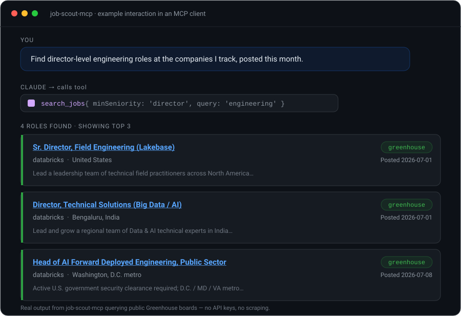

# job-scout-mcp

A [Model Context Protocol](https://modelcontextprotocol.io) server that scouts job
openings from **public, ToS-clean sources** and hands them to any MCP client
(Claude Desktop, Claude Code, Cursor, etc.) as structured tools.

It runs with **zero API keys** out of the box, and lights up extra sources when
you add free credentials. No scraping, no logins, no terms-of-service gray area —
every source is either an official API or a public job-board endpoint meant to be
read programmatically.

## Demo

Ask your MCP client for leadership roles, and the server queries the right boards
and returns ranked, filtered results:

<!--
  DROP-IN A REAL SCREENSHOT:
  1. In Claude Desktop, add this server (see "Use with Claude Desktop" below),
     run a query, and screenshot the exchange.
  2. Save it as assets/demo.png in this repo.
  3. Replace the image line below with:
        
     and delete the <sub>…</sub> caption line.
-->


<sub>Illustrative example rendered from real server output against public Greenhouse boards — swap in a real Claude Desktop screenshot (see the comment in this file's source).</sub>

## Why this design

Most "job scraper" projects break the moment a site changes its HTML, get IP-banned,
or quietly violate a platform's terms. This server takes the opposite approach:

- **Applicant Tracking System boards** (Greenhouse, Lever, Ashby) expose public JSON
  feeds per company — this is where real senior/leadership roles are posted first.
- **Hacker News "Who is Hiring"** is read through the free Algolia HN API.
- **RemoteOK** publishes a free JSON feed (with attribution).
- **Adzuna** and **USAJobs** are official APIs with free developer keys.

The result is stable, legal, and genuinely useful — especially for scouting
senior, manager, director, and executive roles.

## Sources

| Source | Auth | What it covers |
|---|---|---|
| **Greenhouse** | none | All public roles at any company on Greenhouse |
| **Lever** | none | All public roles at any company on Lever |
| **Ashby** | none | All public roles at any company on Ashby |
| **Hacker News** | none | Latest monthly "Who is Hiring" thread |
| **RemoteOK** | none | Remote-friendly roles (attribution required) |
| **Adzuna** | free key | Broad aggregated search + salary histograms |
| **USAJobs** | free key | US federal government roles |

## Tools

| Tool | Description |
|---|---|
| `search_jobs` | Search all enabled sources with free-text, location, seniority, remote-only, and date filters. |
| `list_company_jobs` | List every open role at one company via its ATS (`greenhouse`/`lever`/`ashby` + slug). |
| `salary_context` | Salary distribution for a role/region (requires Adzuna). |
| `list_sources` | Show which sources are enabled and why any are disabled. |

`minSeniority` accepts `any`, `mid`, `senior`, `lead`, `manager`, `director`, `vp`,
`exec` — seniority is inferred from the job title, so you can filter a company's
whole board down to just leadership roles.

## Install

```bash
git clone https://github.com/pabnatanawan87/job-scout-mcp.git
cd job-scout-mcp
npm install
npm run build
```

## Configure (optional)

Everything works keyless. To enable extra sources or set default tracked
companies, copy `.env.example` to `.env` and fill in what you want:

```bash
cp .env.example .env
```

Find a company's ATS slug from its careers URL and add it to `TRACKED_COMPANIES`
as `provider:slug` (e.g. `greenhouse:stripe,lever:netflix,ashby:notion`). Tracked
companies are searched automatically by `search_jobs`.

## Use with Claude Desktop

Add this to your `claude_desktop_config.json`
(`%APPDATA%\Claude\claude_desktop_config.json` on Windows,
`~/Library/Application Support/Claude/claude_desktop_config.json` on macOS):

```json
{
  "mcpServers": {
    "job-scout": {
      "command": "node",
      "args": ["C:/absolute/path/to/job-scout-mcp/dist/index.js"],
      "env": {
        "TRACKED_COMPANIES": "greenhouse:stripe,lever:netflix,ashby:notion"
      }
    }
  }
}
```

Restart Claude Desktop, then ask things like:

> _"Find director-level engineering roles at the companies I track, posted this month."_
>
> _"List all open manager roles at Stripe."_
>
> _"What's the salary range for an engineering director in London?"_

## Use with Claude Code

```bash
claude mcp add job-scout -- node C:/absolute/path/to/job-scout-mcp/dist/index.js
```

## Develop

```bash
npm run watch     # recompile on change
npm run inspect   # launch the MCP Inspector against the server
```

## How it's built

```
src/
├── index.ts          # MCP server + tool registration (stdio transport)
├── types.ts          # Normalized Job model + Source contract
├── config.ts         # Environment-driven configuration
├── http.ts           # fetch + TTL cache + polite User-Agent
├── filter.ts         # Seniority inference, text/location/date filters, ranking
├── format.ts         # Markdown rendering of results
└── sources/          # One module per source, all implementing `Source`
    ├── greenhouse.ts  lever.ts  ashby.ts
    ├── hnhiring.ts    remoteok.ts
    └── adzuna.ts      usajobs.ts
```

Adding a source is one file: implement the `Source` interface (`name`,
`isEnabled`, `search`) and register it in `sources/index.ts`. Each source maps its
raw response into the shared `Job` shape, so filtering, ranking, and rendering are
identical across all of them.

## License

MIT — see [LICENSE](LICENSE).
